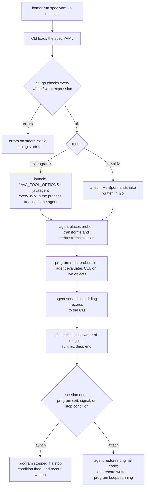
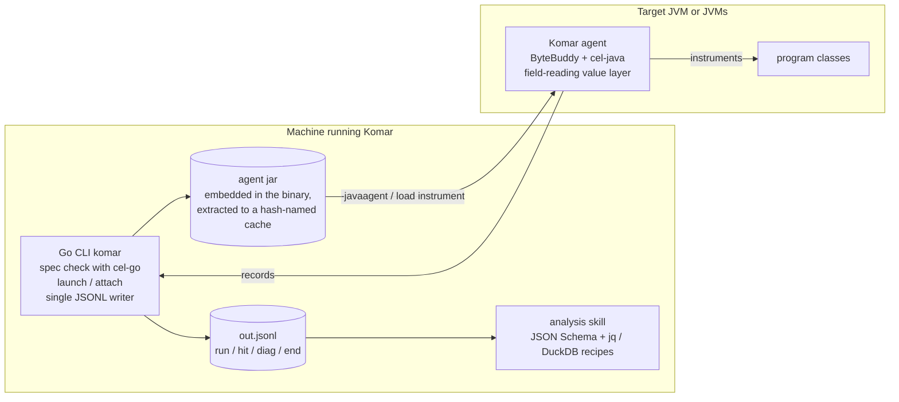

# Komar — MVP Design

Komar lets an AI agent watch what a running program does without changing its code. The agent
writes a small YAML file of **probes**: where to look, when to record, and what to capture. Then it
runs one command, `komar run`, which either starts the program or attaches to one that is already
running. Komar records every probe hit as one line in a JSONL file, which the agent reads
afterwards with jq, DuckDB or the Komar analysis skill.

**Status.** Design for the MVP, JVM only ("MVP, JVM only"); not implemented yet. These documents
are the source of truth for the design. The decisions were recorded during the design interview in
the note `.tasks/feature-design/mvp-jvm.md`, which is ephemeral and git-ignored.

## Who it is for and why

The main user is an AI agent doing ad-hoc instrumentation while it works on a task. The intent, in
the author's words from `initial-prompt.md`:

- "friendliness for AI agents to use the tool and make ad-hoc instrumentations for tasks"
- "simple interface with less actions needed"
- "single spec format for all envs"

One principle, stated during the design interview, guided many later choices (D-17):
"i like the forgiving design for AI agents".

## How a run works



## Components



## Komar in one example

A spec with a method probe, a line probe, a call-site probe and a constructor probe:

```yaml
version: 1                                 # optional (D-46)
calls: false                               # method calls in expressions are off (D-14)
limits: { depth: 3, items: 100, string: 1000, fields: 50, max_hits: 1000, classes: 50, call_ms: 50 }
stop: { after: 60s, hits: 500 }            # optional; in launch mode also ends the program (D-28)
jvm: { main: 'com.shop.App' }              # optional; default is every JVM (D-27)

probes:
  - id: charge                             # method probe
    where:
      class: com.shop.Billing
      method: charge
      params: [Order]
      at: [entry, exit, exception]
    when: 'vars.order.total > 1000'
    what:
      - args
      - ret                                # only at exit (D-17)
      - error: exception.message           # only at exception
      - ms: duration                       # milliseconds (D-43)

  - id: loop                               # line probe
    where: { class: com.shop.Billing, method: charge, line: [51, 57] }
    what:
      - i: vars.i

  - id: gw                                 # call-site probe
    where:
      class: com.shop.Billing
      method: charge
      call: { class: com.pay.PaymentGateway, subtypes: true, method: send }
      at: [before, after, exception]
    what:
      - order: call.args[0]
      - gateway: call.target

  - id: created                            # constructor (D-42)
    where: { class: com.shop.Order, method: new, at: [exit] }
    what: [this]
```

Part of the output of `komar run spec.yaml -o out.jsonl -- java -jar app.jar`:

```jsonl
{"kind":"run","format":1,"komar":"0.1.0","spec":"spec.yaml","cmd":["java","-jar","app.jar"],"start":"2026-10-09T12:00:00Z"}
{"kind":"diag","level":"info","probe":"charge","msg":"placed","methods":1,"pid":4242}
{"kind":"hit","probe":"charge","point":"entry","method":"com.shop.Billing.charge(Order)","call":7,"parent":null,"thread":{"id":1,"name":"main"},"pid":4242,"ts":"2026-10-09T12:00:01.200000Z","t":1200000000,"seq":3,"what":{"args":[{"@type":"com.shop.Order","id":42,"total":1500.0}]}}
{"kind":"hit","probe":"charge","point":"exit","method":"com.shop.Billing.charge(Order)","call":7,"parent":null,"thread":{"id":1,"name":"main"},"pid":4242,"ts":"2026-10-09T12:00:01.212500Z","t":1212500000,"seq":6,"what":{"args":[{"@type":"com.shop.Order","id":42,"total":1500.0}],"ret":true,"ms":12.5}}
{"kind":"end","reason":"stop","code":null,"hits":{"charge":2},"dropped":0,"when_errors":{}}
```

The entry and exit hits share `call: 7`, so analysis can pair them. The keys under `what` are
exactly the keys written under `what:` in the spec (D-16, D-26).

## Design principles

| Principle | What it means in the design |
|---|---|
| KISS: one command | The CLI has one command, `komar run`, with `-o`, `-p <pid>` or `-- <program>`. Everything else lives in the spec (D-1, D-14, D-28). |
| Forgiving for AI agents | Spec errors are reported all at once with a suggestion, before anything starts (D-33). A value missing at a point is left out instead of failing (D-17). A condition that cannot apply is false and explained once (D-18, D-30). |
| Observation never changes program code | Values are read from fields, not getters. Program methods run only when the spec sets `calls: true` (D-13, D-14). On detach the original code is restored (D-29). |
| One spec format for all runtimes | `where` is structured and source-oriented, and program names live under `vars.`, so a later Python runtime can map the same spec (D-2, D-19). |
| Output maps to the spec | One record per hit; `probe` and `point` name the spec entry, and `what` mirrors the spec's `what` (D-5, D-16, D-26). |

## Reading order

| Document | What it covers |
|---|---|
| [spec-language.md](spec-language.md) | The spec YAML: probes, `where` / `when` / `what`, spec-wide keys, and the CEL environment. |
| [output-format.md](output-format.md) | The JSONL file: record kinds, the hit envelope, value encoding, `@` markers, timestamps, call ids. |
| [jvm-runtime.md](jvm-runtime.md) | The JVM side: the agent, launch and attach, the channel to the CLI, value reading, distribution, several JVMs. |
| [lifecycle-and-failures.md](lifecycle-and-failures.md) | Sessions, `stop`, detach, limits, error handling, diagnostics and exit codes. |
| [decisions.md](decisions.md) | The decision log D-1 to D-46 and the rejected alternatives. |
| [scope-and-roadmap.md](scope-and-roadmap.md) | Non-goals, postponed items, open questions, unknowns, the verification plan and risks. |
| [prior-art.md](prior-art.md) | What existing tools do, with anchors to their sources. |

## Glossary

These words carry one meaning across all design documents.

| Term | Meaning |
|---|---|
| probe | One entry in the spec's `probes:` list: an `id`, a `where`, an optional `when` and a `what`. |
| point | A place in the code where a probe can fire: `entry`, `exit`, `exception`, a source `line`, or `before` / `after` / `exception` at a call site. |
| hit | One firing of a probe at one point whose `when` held. Each hit becomes one `hit` record. |
| place | To install a probe into the target: transform the matching classes so the points fire. |
| capture | To evaluate the `what` expressions at a hit and record their values. |
| session (run) | One `komar run` from start to end: one output file, one `run` record, one `end` record. |
| agent | The Komar Java agent inside each target JVM. It places probes and evaluates CEL. |
| CLI | The `komar` Go binary. It checks the spec, launches or attaches, and writes the output file. |
| call id | `call` in a hit record: identifies one execution of a probed method. All records of that execution share it. |
| parent | `parent` in a hit record: the call id of the nearest enclosing probed call on the same execution unit. |
| execution unit | The unit call trees follow: a thread on the JVM (a task in a future Python runtime). |
| diag | A diagnostic record (`kind: "diag"`): probe placed, matched nothing, condition errors, caps reached. |
| end record | The last record (`kind: "end"`): why the session ended, counts per probe, dropped records. |
| `@` markers | Keys starting with `@` inside captured values: Komar's metadata such as `@type`, `@truncated`, `@size`, `@ref`, `@error`. |

## Status of names

Several names in these documents are working names or proposals, not final decisions:

- record field names in the hit envelope (D-26) and in `run`, `diag` and `end` records;
- `@` marker names (D-22);
- exit-code numbers (D-32);
- some defaults: `call_ms`, `max_hits` and `classes`, which are unmeasured proposals (D-31, D-34);
- the version markers (D-46), which were delegated rather than decided.

See the open questions in [scope-and-roadmap.md](scope-and-roadmap.md).
