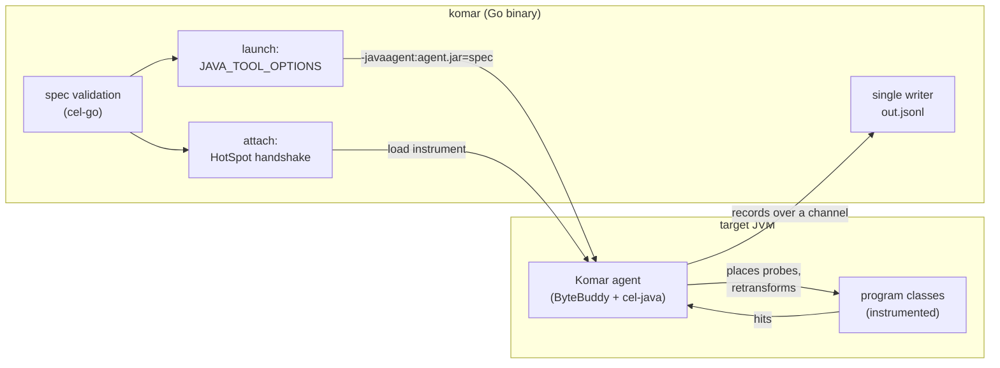
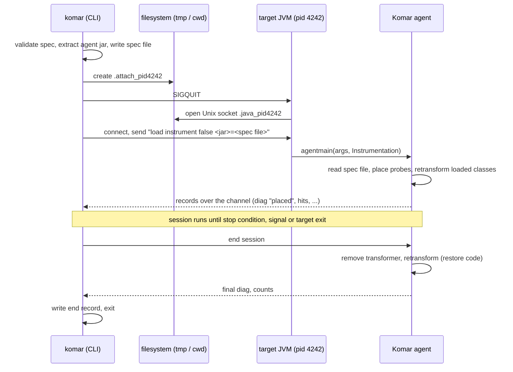
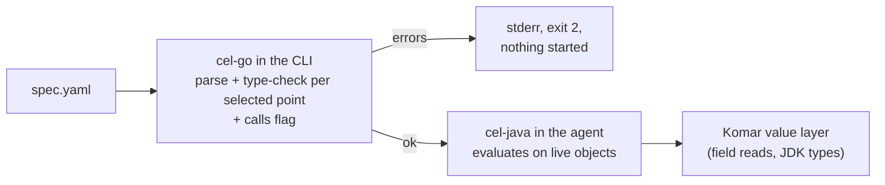
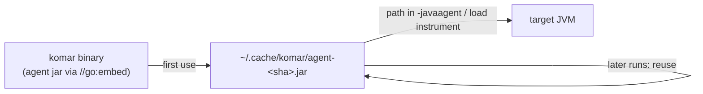

# JVM runtime

How Komar observes a JVM program: the mechanism, the supported targets, how the agent gets into
the JVM, what it does there, and how records reach the output file. The spec language is described in
[spec-language.md](spec-language.md), the output records in [output-format.md](output-format.md),
and session start, stop and failures in [lifecycle-and-failures.md](lifecycle-and-failures.md).
Decision references such as `(D-1)` point to [decisions.md](decisions.md).

Status: design for the MVP. Nothing here is implemented yet.

## At a glance



- The CLI checks the spec, then either launches the program with the agent or attaches the agent to
  a running JVM.
- The agent places probes by rewriting bytecode of the matching methods and evaluates conditions and
  captures in the target JVM.
- Every record goes back to the CLI, which is the only process that writes the output file.

## Mechanism and why (D-1)

Komar uses an **in-process Java agent with bytecode advice and retransformation**. The agent is
loaded at JVM start through `-javaagent` (set via `JAVA_TOOL_OPTIONS`), or into a running JVM through
the HotSpot attach mechanism. Already-loaded classes are retransformed, and classes loaded later are
transformed as they load.

The decisive requirement is that one mechanism serves both `komar run ... -- <program>` (launch) and
`komar run ... -p <pid>` (attach) on an ordinary JVM that was started without special flags. Only a
Java agent that rewrites bytecode meets it. The alternatives fail on attach or on capturing values:

| Alternative | Why it lost | Anchor |
|---|---|---|
| External debugger over JDI/JDWP | needs the target started with `-agentlib:jdwp`, so it cannot serve `-p <pid>` on an ordinary JVM | https://docs.oracle.com/en/java/javase/25/docs/specs/jpda/conninv.html (not checked by us); HotSpot `jvmtiManageCapabilities.cpp` at `jdk-25+36` |
| Native JVMTI agent with breakpoints / method events | breakpoint, field-watch, method entry/exit, exception and local-variable capabilities are OnLoad-only, so on attach it gives nothing beyond a Java agent, at the cost of a native build per platform | openjdk/jdk `jdk-25+36` `src/hotspot/share/prims/jvmtiManageCapabilities.cpp` (`init_onload_capabilities`, `init_onload_solo_capabilities`) |
| JFR method tracing (JEP 520) | JDK 25+ only; records timing and stack, no arguments or field values | https://openjdk.org/jeps/520 §Non-Goals |

The same HotSpot source shows that retransformation is an "always" capability, available in the live
phase, which is what the Java agent route relies on. JFR method tracing remains a candidate for a
future auxiliary event source, not a probe mechanism.

Agent loading itself is specified in the `java.lang.instrument` package summary (JDK 21):
https://docs.oracle.com/en/java/javase/21/docs/api/java.instrument/java/lang/instrument/package-summary.html
§Starting an agent, §Loading agent classes. Agent classes load in the system class loader, and the
`Can-Retransform-Classes` manifest attribute enables retransformation.

## Supported targets

| Dimension | MVP | Decision |
|---|---|---|
| Target Java version | Java 8 and newer; the agent is compiled for Java 8 bytecode | D-3 |
| Launch mode (`-- <program>`) | any JVM that honours `JAVA_TOOL_OPTIONS`; only HotSpot on Linux and macOS is in the test matrix | D-4, D-41 |
| Attach mode (`-p <pid>`) | HotSpot on Linux and macOS; Komar and the target run as the same user | D-4 |
| Attach on Windows or OpenJ9 | refused with an "attach not supported" error (exit 3) | D-4, D-32 |
| Target in another container | refused (exit 3) with a suggestion to run `komar` inside that container | D-38 |
| GraalVM native executables | not supported: bytecode cannot be transformed while a native image runs | D-4, D-45 |
| Machine running `komar` | no JDK needed; the CLI performs the attach handshake itself | D-3, D-37 |

The Java 8 floor has consequences for the agent:

- The JDK Class-File API (final in JDK 24, https://openjdk.org/jeps/484) cannot be used, so the
  bytecode library is ByteBuddy (D-36).
- The test matrix covers Java 8, 11, 17, 21 and the current JDK, so both pre-module and module JVMs
  are tested (D-3, D-41).

GraalVM evidence: GraalVM maintainers state that bytecode transformation cannot happen at image run
time (oracle/graal discussion #6693). It is a Q&A thread, so it supports the exclusion rather than
anchoring it alone.

## Launch path

```text
komar run spec.yaml -o out -- java -jar app.jar
```

1. The CLI validates the spec (see [lifecycle-and-failures.md](lifecycle-and-failures.md#spec-errors)).
2. It extracts the embedded agent jar to its cache (see [Distribution](#distribution-d-39)).
3. It writes the spec and the address of its record channel to a file.
4. It starts the command with `JAVA_TOOL_OPTIONS` extended by
   `-javaagent:<cache>/agent-<sha>.jar=<spec file>`. An existing value of the variable is kept, and
   the agent option is appended to it.

The HotSpot VM reads `JAVA_TOOL_OPTIONS` itself, "so that agents may be launched" when the command
line cannot be changed (JVMTI 21 spec, https://docs.oracle.com/en/java/javase/21/docs/specs/jvmti.html
§JAVA_TOOL_OPTIONS). This lets Komar wrap `java`, Gradle, Maven or a shell script without editing the
command. The JVM prints `Picked up JAVA_TOOL_OPTIONS: ...` on its stderr (research finding, not
checked by us).

**Several JVMs (D-27).** Every JVM in the launched process tree inherits the variable and loads the
agent: a Gradle client, its daemon and forked test JVMs alike. All of them record. Each sends its
records to the CLI, and every record carries the JVM's `pid`. An optional spec-wide filter makes
non-matching JVMs load the agent and stay idle:

```yaml
jvm: { main: 'com.shop.App' }     # optional; default is every JVM
```

Which keys besides the main class the filter matches on is not decided
([open questions](scope-and-roadmap.md#open-questions)). Whether Gradle and Maven forked test JVMs
inherit the environment by default was not checked in their documentation.

Launching at start has a further advantage: agents loaded with `-javaagent` never trigger the JEP 451
dynamic-loading warning.

## Attach path (D-37)

```text
komar run spec.yaml -o out -p 4242
```

The CLI implements the HotSpot POSIX attach handshake in Go, following the design of jattach
(Apache-2.0). No JDK and no helper binary is needed on the machine running `komar`.



Key facts behind the handshake:

- **The protocol is internal.** It is described only in JDK source comments, not in a specification.
  jattach's implementation is the reference: github.com/jattach/jattach `src/posix/jattach_hotspot.c:24-82`.
- **The spec travels as a file path.** On JDK 21 each attach argument is limited to 1,024 characters
  (openjdk/jdk tag `jdk-21-ga` `src/hotspot/share/services/attachListener.hpp`, `arg_length_max = 1024`,
  `arg_count_max = 3`). A spec does not fit, so the agent receives the path of a file.
- **Same user.** The JVM checks the peer's credentials on the socket; Komar must run as the target's
  user (research finding; jattach switches to the target's uid when run as root).
- **JEP 451.** Since JDK 21 the JVM prints a warning on its stderr when an agent is loaded
  dynamically. "In some future release, the dynamic loading of agents will be disallowed by default",
  unless the target runs with `-XX:+EnableDynamicAgentLoading` (https://openjdk.org/jeps/451
  §Description). No release is named. Launch mode is unaffected. Until then, `-p` is best effort on
  future JDKs.
- **Containers.** Attaching from the host into a container needs namespace handling, a copy of the
  agent jar inside the container, and a different record channel. All of it is postponed (D-38).

Rejected attach clients (D-37): shipping the jattach binary (a native binary per OS and CPU),
a Java helper with `com.sun.tools.attach` (needs a full JDK, contradicts D-3), and a young Go library
(`vlsi/jattach-go`, not reviewed).

## Agent internals

### Bytecode library (D-36)

The agent is built on **ByteBuddy** (Apache-2.0, bundles ASM, runs on JVM 8+, supports new class-file
versions through its Class-File API integration since 1.17.0).

- **Method points** (entry, exit, exception) use ByteBuddy `Advice`, which wraps the whole method.
  Exit advice runs on exceptions by default (`Advice.OnMethodExit.onThrowable`), so exceptional exits
  are never missed.
- **Line and call-site points** use the ASM visitor layer that ByteBuddy exposes: "Advice can be used
  either as a AsmVisitorWrapper" (https://javadoc.io/static/net.bytebuddy/byte-buddy/1.18.14/net/bytebuddy/asm/Advice.html).
- ASM-only was rejected: about 0.26 MB instead of about 4.7 MB, but Komar would own stack frames,
  exception paths and agent setup itself.

### Placing probes

- On attach, the agent registers a retransformation-capable transformer and retransforms the loaded
  classes that match. Classes loaded later are transformed when they load, since a registered
  transformer sees "all future class definitions".
- Retransformation may change method bodies only. It cannot add fields or methods, so all agent state
  lives outside the program's classes.
- "If a retransformed method has active stack frames, those active frames continue to run the
  bytecodes of the original method" (https://docs.oracle.com/en/java/javase/21/docs/api/java.instrument/java/lang/instrument/Instrumentation.html#retransformClasses(java.lang.Class...)).
  Methods already running at attach are therefore not observed until their next call.
- Hidden classes, which include lambda proxy classes, cannot be retransformed (research finding).
  Lambda bodies are reached through the synthetic method of the enclosing class instead (see below).
- A `where` that matches more classes than the `classes` limit is a spec error before launch; classes
  that cross the limit only later, as they load, are skipped and reported
  ([lifecycle-and-failures.md](lifecycle-and-failures.md#volume-limits-d-34-d-44)).

### Probe kinds and how they are placed

| Probe kind | How it is placed | Decisions |
|---|---|---|
| Method: `entry`, `exit`, `exception` | `Advice` around the method body; constructors included | D-2, D-5, D-9 |
| Line | code inserted at the bytecode offset where the line starts in `LineNumberTable` | D-2, D-8 |
| Call site: `before`, `after`, `exception` | code around each candidate invoke instruction in the probed method; the call is wrapped in a handler that records the exception and rethrows it unchanged | D-8, D-9, D-10 |
| Constructor (`method: new`) | `Advice` on `<init>`; `this` is not available at entry | D-11, D-42 |

Details per kind:

- **Exceptions are rethrown unchanged (D-9).** A JVM exception handler can cover a single invoke
  instruction (https://docs.oracle.com/javase/specs/jvms/se21/html/jvms-4.html §4.7.3,
  `exception_table`), so the call-site `exception` point records and rethrows without changing what
  the program sees.
- **Call targets are matched by run-time class (D-10).** The invoke instruction names the declared
  ("qualifying") class (https://docs.oracle.com/javase/specs/jls/se21/html/jls-13.html §13.1 item 5).
  The method actually run is selected from the receiver's run-time class
  (https://docs.oracle.com/javase/specs/jvms/se21/html/jvms-6.html §6.5 `invokevirtual`,
  `invokeinterface`). The agent instruments every invoke whose method name and parameter list could
  reach the target, then checks the receiver's class when the call runs. Static calls match by the
  named class.
- **Overloads (D-7).** Parameter lists in source syntax are converted to JVM descriptors at placement
  (https://docs.oracle.com/javase/specs/jvms/se21/html/jvms-4.html §4.3.3). Type arguments are ignored
  (they do not exist at run time), `T...` means `T[]` (`ACC_VARARGS`, JVMS §4.6), and a type-variable
  name is matched through the method's `Signature` attribute (JVMS §4.7.9.1). Bridge methods are
  skipped.
- **Constructors (D-11).** At constructor entry the object does not exist yet, so `this` is only
  available at `exit` and `exception` (ByteBuddy `Advice.This` §optional,
  https://javadoc.io/static/net.bytebuddy/byte-buddy/1.18.14/net/bytebuddy/asm/Advice.html).
  Static initializers are not probe targets.

### Lambdas and anonymous classes (D-12)

Agents copy line numbers from source, and a line inside a lambda is not in the enclosing method's
bytecode:

- javac desugars a lambda body into a private synthetic method of the same class, with a
  compiler-chosen name (https://cr.openjdk.org/~briangoetz/lambda/lambda-translation.html §Lambda body
  desugaring). The agent finds these methods through the `invokedynamic` instructions of the named
  method, all within one class file.
- Anonymous and local classes are separate classes (`Billing$1`). The only link back is the optional
  `EnclosingMethod` attribute. The agent also transforms these classes when they load later.

A line or call-site probe on method `M` therefore covers `M`'s own code, lambda bodies created in `M`,
and methods of anonymous and local classes declared in `M`. Each record names both the method that
actually ran and the method named in the spec. Method-kind probes (`at: entry/exit/exception`) still
target `M` only; that last point is a reading of D-12, not asked separately.

### Debug information the agent depends on

| Feature | Needs in the class file | Default `javac` | Source |
|---|---|---|---|
| Line probes | `LineNumberTable` | emitted | https://docs.oracle.com/javase/specs/jvms/se21/html/jvms-4.html §4.7.12 |
| `vars.<local>` | `LocalVariableTable` | only with `-g` / `-g:vars` | https://docs.oracle.com/javase/specs/jvms/se21/html/jvms-4.html §4.7.13; https://docs.oracle.com/en/java/javase/21/docs/specs/man/javac.html §Standard Options `-g` |
| `vars.<parameter>` | `MethodParameters` or `LocalVariableTable` | only with `-parameters` or `-g` | javac man page, JDK 21 |
| Type-variable names in `params` | `Signature` | emitted for generic declarations | JVMS SE 21 §4.7.9.1 |
| Anonymous/local classes for line probes | `EnclosingMethod` | emitted | JLS SE 21 §13.1 |

ProGuard's obfuscation step discards `Signature`, `LineNumberTable`, `LocalVariableTable`,
`MethodParameters`, `SourceFile` and others by default
(https://www.guardsquare.com/manual/configuration/attributes §Optional attributes). Obfuscation also
renames classes and methods, so such builds do not match by source names anyway. Missing debug
information is never silent: a missing `vars.x` is omitted from the record or makes the condition
false, and Komar reports why, for example "compiled without `-g`" (D-17, D-18, D-19).

### Call ids and the per-thread call stack (D-21)

Every hit record carries `call`, `parent` and `thread` ([output-format.md](output-format.md)). The
agent keeps a small stack of active probed calls per thread:

- At a probed method's entry it pushes a new call id. The id below it becomes `parent`.
- At normal or exceptional exit it pops the id.
- For line and call-site probes the agent tracks the enclosing method's entry and exit even when the
  spec did not select those points. That costs instrumentation, not extra records.
- Unprobed methods in between are invisible, so `parent` is the nearest *probed* ancestor, not the
  direct caller.

Precedents: BTrace `@TLS` per-thread state paired across entry and return, JFR `@Contextual`
("applies to all events happening in the same thread from the beginning to the end of the event",
https://docs.oracle.com/en/java/javase/25/docs/api/jdk.jfr/jdk/jfr/Contextual.html). Virtual threads
support thread-locals (https://openjdk.org/jeps/444 §Thread-local variables), so one virtual thread
per request works; the JEP warns to keep per-thread state small. The thread id comes from
`Thread.threadId()`, "generated when a Thread is created and cannot be changed"
(https://docs.oracle.com/en/java/javase/21/docs/api/java.base/java/lang/Thread.html). On Java 8 the
method is `getId()`; whether ids are reused there is not verified.

The model's gaps are listed under [Known gaps](#known-gaps).

## Reading values (D-13, D-15)

Observation must not change the program. The default for every value a `when` or `what` touches is
therefore a **field read**: no method of the program runs.

| Value | How the agent reads it |
|---|---|
| Object of an application class | fields read directly, private ones included, up to the capture limits |
| Exact JDK types: strings, boxed numbers, `BigDecimal`, `java.time` types, enums, lists, sets, maps, arrays | rendered as plain JSON values; only when the class is exactly the JDK class, not a subclass that could override `size()` or `iterator()` |
| A failure while reading (e.g. a concurrent modification of a map) | stays inside the agent; the value becomes `{"@error": "..."}` |

Why Komar has its own value layer: cel-java's support for plain Java objects resolves a property
`x.total` to the public getter `getTotal()` / `isTotal()` first, falls back only to a **public** field,
and cannot reach private fields (github.com/google/cel-java `d9cf3f98`
`extensions/src/main/java/dev/cel/extensions/CelNativeTypesExtensions.java:361-381`, `:530-567`,
checked). Used as is, it would run getters on every property read. Komar instead plugs its own value
provider into cel-java, which maps property reads to field reads. cel-java's `StructValue` /
`CelValueProvider` are the extension points; their API was not read yet.

### Opt-in method calls (D-13, D-14)

The design's rule is: Komar never changes program code, and observation runs program code only when
the spec asks for it explicitly. The spec asks with one top-level flag:

```yaml
calls: true      # default false: any x.m() in any probe is a spec error naming this flag
probes:
  - id: charge
    where: { class: com.shop.Billing, method: charge, at: [entry] }
    when: 'args[0].getTotal() > 1000'
    what: [args[0].customer, args[0].toString()]
```

`x.total` always reads the field. `x.getTotal()` calls the method. Records whose values came from a
call are marked (`"called": true`).

### Guardrails for calls (D-31)

| Risk | What the agent does | Source |
|---|---|---|
| The called method throws | caught inside the agent; the value becomes `{"@error": "..."}`; the exception never reaches the program | D-22 |
| The call triggers probes (re-entry) | while Komar evaluates an expression on a thread, probes on that thread do not fire | Byteman documents "an infinite triggering chain" and `setTriggering(false)` (Byteman built-ins §Recursive Triggering) |
| The call is slow | measured after it returns; after the first call over `call_ms`, that probe's call expressions return `{"@error":"calls disabled: slow call (X ms)"}` for the rest of the session, with one `diag` | D-31 |

A running Java method cannot be aborted safely from outside: `Thread.stop` is deprecated for removal
(https://docs.oracle.com/en/java/javase/21/docs/api/java.base/java/lang/Thread.html). That is why a
slow call can only be detected, not cut short. The `call_ms` default of 50 ms is a proposal, not
confirmed ([open questions](scope-and-roadmap.md#open-questions)). Side effects a call performs before
it throws or while it is slow are not undone: that is the cost of `calls: true`.

## CEL evaluation (D-15)



- **Where.** Expressions that call methods need live objects (D-13), and shipping every hit's values
  out of the JVM to filter them in Go would cost more than filtering in place. So evaluation happens
  in the target JVM.
- **Checked first.** The CLI parses and type-checks every `when` and `what` with cel-go before
  launch or attach, once per selected point. It also enforces the `calls` flag and the D-18 warnings.
  An agent therefore never sees a spec error after the program has started.
- **Evaluated in the agent** by cel-java 0.14.x (Java 8+, `README.md:366`), through Komar's value
  layer.
- **Keeping two implementations equal.** The shared CEL conformance tests
  (github.com/google/cel-spec `40a3c90` `tests/simple/testdata/*.textproto`) run against both cel-go
  and cel-java, at least for the subset Komar uses. Whether they agree on that subset is still an open
  measurement.
- **Dependencies are relocated.** cel-java 0.14.0 depends on guava 33.6.0-jre, protobuf-java 4.35.1,
  antlr4-runtime, re2j, threeten-extra and snakeyaml (Maven Central POM). They are relocated inside the
  agent jar together with ByteBuddy, so they cannot clash with the program's own copies.

CEL itself is side-effect-free and has no assignment (github.com/google/cel-spec master
`doc/langdef.md` §Overview, §Syntax). `&&` and `||` absorb an error when the other side decides the
result, so `has(vars.order.customer) && vars.order.customer.vip` never fails (§Logical Operators).

## CLI ↔ agent channel (D-27, D-34)

- **The CLI is the single writer** of the output file. Agents never open it. That is what gives the
  file one `run` header, one `end` record and one global `seq` order across several JVMs.
- **Agents send records over a channel** to the `komar` process. The CLI passes the channel's
  address in the spec file. The transport (loopback TCP, or a Unix socket, which Java supports only
  from JDK 16 per research) is an implementation detail.
- **The program is never blocked.** If the CLI cannot keep up, the agent drops records and counts
  them. The count appears as `dropped` in the `end` record. A blocked application thread would change
  the program's timing, which is the one thing observation must not do.

## Distribution (D-39)



- The agent jar is embedded in the Go binary with `//go:embed` (https://pkg.go.dev/embed §Strings and
  Bytes, §File Systems).
- On first use the CLI extracts it to a cache path named after its hash and reuses it on later runs.
  The path is readable by the target JVM's user, which is the same user for `-p` (D-4).
- CLI and agent versions cannot drift: one binary carries both halves of the record and spec
  protocol.
- Precedent: Grafana Alloy embeds async-profiler and extracts it to `<tmp>/alloy-asprof-<sha1>/`
  after checking temp-directory permissions (github.com/grafana/alloy main
  `internal/component/pyroscope/java/asprof/asprof.go`, `Archive.DistName`, `ExtractDistribution`,
  `checkTempDirPermissions`).
- Size: cel-java and its dependencies add about 5–7 MB and ByteBuddy about 4.7 MB before shrinking.
  The final size of the shrunk jar is not measured yet.
- An override path for developing Komar itself is an implementation detail.

Rejected: downloading the jar on first use (needs network, often blocked in CI or production), and
installing it next to the binary (can go missing or drift in version).

## Known gaps

| Gap | Effect | Status |
|---|---|---|
| Work handed to another thread (executors, `CompletableFuture`, reactive, coroutines) | the work starts a new call tree with `parent: null` | MVP: documented; correlate by a captured program value. Hand-off links are postponed (D-21) |
| Methods already running at `-p` attach | their entry and exit are never seen; calls inside them appear as roots | inherent to retransformation; documented |
| Removed transformer may still be called briefly on detach | the agent must tolerate late calls | "it is possible for a transformer to receive calls after it has been removed" (JDK 21 `Instrumentation` §removeTransformer) |
| JEP 451 future default | `-p` may need `-XX:+EnableDynamicAgentLoading` on the target in a future JDK | no release named; launch mode unaffected |
| Missing debug info (`-g`, `-parameters`) or obfuscation | no locals or parameter names; no line probes without `LineNumberTable` | reported per probe, never silent |
| Lambda proxy classes (hidden classes) | cannot be retransformed | lambda bodies are reached through their synthetic methods instead |
| Several JVMs per launch | build-tool JVMs pay agent start-up cost | optional `jvm` filter (D-27) |
| Windows, OpenJ9, containers for `-p` | refused with exit 3 | postponed (D-4, D-38) |
| Java 8 clock precision and thread-id reuse | `ts` may have millisecond precision; `thread` uniqueness unverified | open measurement |
| Overhead per hit | no primary source gave numbers | measured by the MVP benchmark (D-41) |
