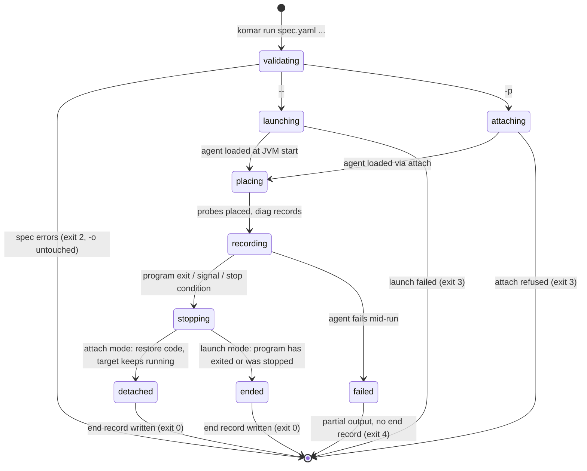

# Lifecycle and failures

How a Komar session starts and ends, what Komar leaves behind in a JVM it attached to, which caps
protect the program, and what happens when something fails. The JVM mechanics behind these steps are
in [jvm-runtime.md](jvm-runtime.md); record shapes are in [output-format.md](output-format.md).
Decision references such as `(D-28)` point to [decisions.md](decisions.md).

Status: design for the MVP. Nothing here is implemented yet.

## Session lifecycle

A **session** is one `komar run` invocation: from reading the spec to writing the `end` record.



| State | What happens | Output |
|---|---|---|
| validating | the CLI checks YAML, keys, CEL types per selected point, the `calls` flag, class-match limits it can check up front | errors and warnings on stderr only |
| launching / attaching | the CLI extracts the agent jar, writes the spec file, starts the program with `JAVA_TOOL_OPTIONS` or performs the attach handshake | `run` header |
| placing | the agent matches classes, transforms or retransforms them | `diag` records ("placed", "no class matched", ...) |
| recording | probes fire, conditions are evaluated, values are captured | `hit` and `diag` records |
| stopping | the session ends for one of the reasons below | — |
| detached / ended | the agent restores code (attach) or the program is gone (launch) | `end` record with the reason and counts |

## What ends a session (D-28)

The session ends at the first of these events. The `end` record says which one.

| Event | Launch mode (`-- <program>`) | Attach mode (`-p <pid>`) |
|---|---|---|
| The program exits | session ends; the program's exit status goes into `end` | session ends; there is nothing left to detach from |
| `komar` receives Ctrl-C / SIGTERM | the signal is forwarded to the program, as any wrapper command does | Komar detaches; the target keeps running |
| A `stop` condition fires | recording ends **and the program is stopped**: SIGTERM, a grace period, then SIGKILL | recording ends, Komar detaches, the target keeps running |

```yaml
stop: { after: 60s, hits: 500 }   # optional; first condition reached ends the session
```

- `after` is a duration of the session. `hits` counts hits across all probes; it is not the per-probe
  cap (that is `limits.max_hits`, see below) (D-44).
- Other kinds of stop conditions are not decided.
- **Launch mode stops the program (D-28 follow-up).** An agent that runs `komar run ... -- java -jar
  server.jar` with `stop` gets a bounded experiment instead of a server left running. The asymmetry
  with attach mode follows from who started the program: Komar only stops what it started.
- The grace period between SIGTERM and SIGKILL is not decided
  ([open questions](scope-and-roadmap.md#open-questions)).
- Without `stop`, an attach session ends only on a signal. An agent then has to interrupt the command
  itself; the `end` record is still written if Komar handles the signal.

## Detach (D-29)

When an attach session ends, the target keeps running with Komar's agent loaded. A Java agent cannot
be unloaded, so its classes stay in memory. What Komar does decide is the state of the instrumented
methods:

1. The agent removes its transformer.
2. It retransforms every class it changed. Retransformation starts "from the initial class file
   bytes" and reapplies only the transformers still registered
   (https://docs.oracle.com/en/java/javase/21/docs/api/java.instrument/java/lang/instrument/Instrumentation.html
   §retransformClasses), so the original code comes back.
3. A class that cannot be restored keeps its probes **switched off** and is listed in a `diag`
   record and in `end`.

Limits documented by the JDK:

- Methods running at that moment keep the instrumented code until they return.
- "It is possible for a transformer to receive calls after it has been removed"
  (same page, §removeTransformer). The agent tolerates late calls and records nothing from them.

Re-attaching to the same JVM later finds the agent's classes already loaded. The CLI starts a new
session inside the existing agent rather than loading a second one. That is an implementation detail.

Rejected: leaving the code instrumented but switched off. Detach would be instant, but the program
would keep changed bytecode and a small cost on every probed call for the rest of its life, against
the rule that Komar never changes program code (D-13).

## Volume limits (D-34, D-44)

A probe on a hot method can fire millions of times, and a broad class pattern can match thousands of
classes. Two caps protect the program and keep the output readable. They live in the same `limits`
map as the capture limits, at the top of the spec or per probe:

```yaml
limits: { max_hits: 1000, classes: 50 }     # spec-wide
probes:
  - id: hot
    where: { class: com.shop.Cache, method: get, at: [exit] }
    limits: { max_hits: 50 }                # this probe only
```

| Limit | Meaning | Default | When it is reached |
|---|---|---|---|
| `max_hits` | hits per probe | 1,000 (proposal, not confirmed) | the probe stops firing; one `diag` says so |
| `classes` | classes a `where` may match | 50 (proposal, not confirmed) | a spec error before launch, showing the match count; classes that cross the cap only later, as they load, are skipped and reported in `diag` |

- The 50 comes from Arthas's default class-match limit (`-m`). The 1,000 is ten times Arthas's
  default hit count (`-n` 100), because a Komar session usually covers a longer scenario than one
  Arthas command. Neither is measured. See [open questions](scope-and-roadmap.md#open-questions).
- Whether the class cap counts per probe or per spec is not decided.
- The per-probe cap is named `max_hits` so that it cannot be confused with `stop.hits`. A `hits` key
  inside `limits`, or `max_hits` inside `stop`, is a spec error with a suggestion (D-44).
- **Never block the program.** If the CLI cannot keep up with writing, the agent drops records and
  counts them. The count is `dropped` in `end`. Rate limiting per probe is postponed (D-34).

Capture limits (depth 3, 100 items, 1,000 characters per string, 50 fields per object; D-23) and how
truncated values are marked are described in [output-format.md](output-format.md).

## Failures

Each row says what triggers the failure, what the agent or user sees, and where it is reported.

| Failure | Result | Reported in | Decision |
|---|---|---|---|
| Spec error: YAML, unknown key, CEL type error, call without `calls: true`, misplaced `hits` / `max_hits`, too many matched classes known up front | nothing is launched or attached; `-o` is not touched | stderr, exit 2 | D-33, D-14, D-44, D-34 |
| `when` uses a value that does not exist at one of the probe's points (e.g. `ret` at `entry`) | that point never fires; the run continues | stderr warning before launch, and a `diag` record | D-18 |
| `what` item that does not exist at a point | the key is omitted from that point's record | — (by design) | D-17 |
| `when` fails at run time (e.g. null dereference) | counts as false: no record for that hit; the probe stays active | first error per probe as a `diag` (message, method, thread); total per probe in `end` (`when_errors`) | D-30 |
| `what` value fails to read | the value becomes `{"@error": "..."}` | in the hit record | D-22 |
| Opt-in call throws | the value becomes `{"@error": "..."}`; the exception never reaches the program | in the hit record | D-31 |
| Opt-in call slower than `call_ms` | that probe's calls are disabled for the session; other values keep coming | one `diag`; later values are `{"@error":"calls disabled: slow call (X ms)"}` | D-31 |
| `where` matches no class or method | the probe never fires | `diag` (`level: error`), e.g. "no class matched com.shop.Repo*" | D-24 |
| `vars.x` missing because of debug info | omitted from `what` / condition false, with the reason ("compiled without `-g`") | `diag` | D-19 |
| Probe reaches `max_hits` | the probe stops firing | one `diag` | D-34 |
| Records cannot be written fast enough | records are dropped, never blocking the program | `dropped` in `end` | D-34 |
| Attach refused: non-HotSpot JVM, Windows, permissions, dynamic loading disabled | nothing is attached | stderr, exit 3 | D-4, D-32 |
| Target in another container | refused, with a suggestion to run `komar` inside the container | stderr, exit 3 | D-38 |
| A class cannot be restored on detach | its probes stay switched off | `diag` and `end` | D-29 |
| The agent fails after the start | the output is partial and has no `end` record | stderr, exit 4 | D-32 |

### Spec errors

Spec errors happen before anything runs, so they go where the agent reads them first: stderr of the
command it just ran (D-33).

- **All errors at once**, not only the first, so the agent can fix them in one edit.
- **Compiler format** with file, line and column, lowercase, no trailing period, as the GNU Coding
  Standards prescribe for noninteractive programs
  (https://www.gnu.org/prep/standards/html_node/Errors.html §4.4).
- **Suggestions** where they are obvious ("did you mean ...").
- **Exit 2**, nothing launched or attached, and the `-o` files are not touched, so an earlier good
  output survives.

```text
$ komar run spec.yaml -o out -- java -jar app.jar
komar: spec.yaml:12:11: unknown key "wher" (did you mean "where"?)
komar: spec.yaml:19:13: when: undeclared reference to "ret" in probe "charge" at point "entry"
komar: spec.yaml:24:9: what: method call "getTotal()" requires "calls: true" at the top of the spec
komar: 3 errors, nothing started
$ echo $?
2
```

Warnings such as the D-18 case use the same format with a `warning:` prefix and do not stop the run.
Once the run starts, they are also written as `diag` records. The `warning:` prefix and the stderr
copy of diagnostics are a proposal, not confirmed ([open questions](scope-and-roadmap.md#open-questions)).
The exact message wording above is illustrative.

Rejected (D-33): writing an output file for a spec error (it would replace the previous good output
with a file for a run that never happened), and JSON on stderr (harder to read at a glance, a second
message format next to the JSONL).

### Run-time `when` errors

The CLI type-checks expressions before launch, but some failures only appear at run time:
`when: 'vars.order.customer.vip'` fails on every call where `customer` is null. A hot probe can hit
that thousands of times a second, so the rule is designed to be quiet and visible at once:

```jsonl
{"kind":"diag","level":"warn","probe":"vip","msg":"when failed: null at vars.order.customer; counted as false","first_at":{"method":"com.shop.Billing.charge(Order)","thread":"http-1"}}
{"kind":"end","reason":"stop","hits":{"vip":12},"when_errors":{"vip":3891}}
```

The failure counts as false, consistent with D-18, where a missing value also makes a condition false.
The probe is never switched off for condition errors (D-30). Writing the condition defensively avoids
the error entirely, because CEL's `&&` absorbs an error when the other side is false:
`has(vars.order.customer) && vars.order.customer.vip`.

## Exit codes (D-32)

`komar`'s exit code describes **Komar's own outcome only**, the same way in launch and attach mode.

| Code | Meaning |
|---|---|
| 0 | recording completed: the program exited, a stop condition fired, or the session was interrupted, and `end` was written |
| 2 | spec invalid; nothing was started or attached |
| 3 | could not launch or attach (unsupported JVM, permissions, attach refused, target in another container) |
| 4 | the agent failed after the start; the output is partial and has no `end` record |

The numbers are working numbers, not confirmed ([open questions](scope-and-roadmap.md#open-questions)).

The launched program's exit status is **not** passed through. It goes into the `end` record (`code`)
and into a one-line summary on stderr. Rationale:

- Komar's job is to observe, so a failing program is the data, not a Komar failure.
- One meaning across launch and attach is more predictable; attach mode has no program status at all.
- An agent can trust `0` to mean "the output file is complete".

Rejected: the wrapper convention of GNU `timeout`, which returns the command's own status and reserves
124–127 and 137 for its own outcomes, with `--preserve-status` to switch behaviour
(https://www.gnu.org/software/coreutils/manual/html_node/timeout-invocation.html §Exit status). With
it, a Komar failure cannot always be told apart from the program exiting with the same code, and the
two modes would mean different things.
