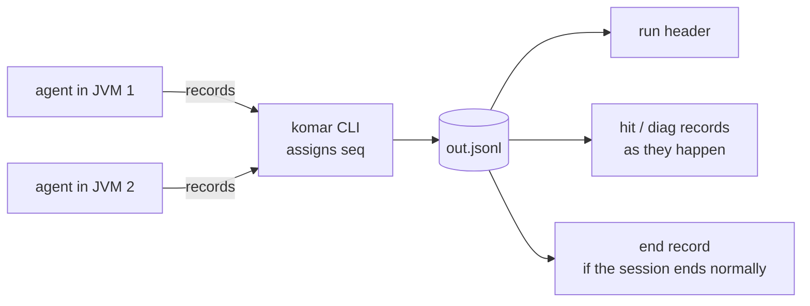
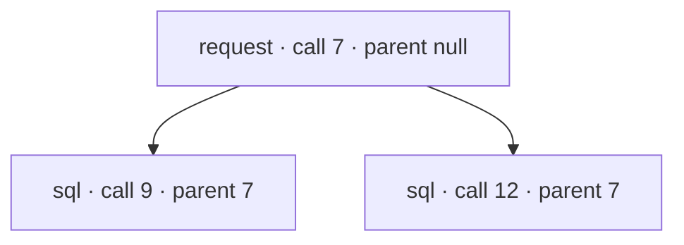

# Output format

What `komar run` writes: one JSONL file per run, and how an agent reads it.

This document describes the design decided for the MVP. Decisions are cited as `(D-n)`; their full
record is in [decisions.md](decisions.md). Items marked *proposal, not confirmed* are listed in
[scope-and-roadmap.md#open-questions](scope-and-roadmap.md#open-questions). Field and marker names
are **working names**: the shape is decided, the exact spelling may still change when the output
schema is written (D-22, D-26).

Related: [spec-language.md](spec-language.md) defines the probes that produce these records,
[lifecycle-and-failures.md](lifecycle-and-failures.md) defines when a session ends and which errors
are reported, [jvm-runtime.md](jvm-runtime.md) explains how the agent produces the data.

---

## 1. One file, one writer

- Every run writes **one** JSONL file, the path given by `-o` (D-24).
- The **CLI is the only writer** of that file. Every JVM in a launched process tree loads the agent
  and sends its records to the `komar` process; no agent ever opens the file (D-27).
- One line is one JSON object. Every object has a `kind` field.
- Line 1 is always the `run` header. A session that ends normally closes the file with an `end`
  record. A crash of `komar` leaves a readable file without `end`.
- Readers ignore kinds they do not know. This leaves room for new kinds, for example other event
  sources, without breaking existing analysis. The same rule is used by the asciicast v2 format:
  a header on line 1, then events, and "a tool which interprets the event stream ... should ignore
  (or pass through) event codes it doesn't understand"
  ([asciicast v2](https://docs.asciinema.org/manual/asciicast/v2/)).



### Record kinds

| `kind` | Written | Key fields |
|---|---|---|
| `run` | once, first line, when the session starts | `format`, Komar version, spec path, command or pid, JVM version, start time |
| `hit` | each time a probe fires at a selected point | envelope (section 3) + `what` |
| `diag` | as they happen: placement results, warnings, errors during the run | `level`, `probe`, `msg`, details |
| `end` | once, last line, when the session ends normally | `reason`, program exit `code`, hits per probe, `dropped`, `when_errors`, unrestored classes |

Spec errors are **not** written to the file. They are reported on stderr before anything starts,
and `-o` is not touched, so an earlier good output survives (D-33).

---

## 2. The `run` header

```jsonl
{"kind":"run","format":1,"komar":"0.1.0","spec":"spec.yaml","cmd":["java","-jar","app.jar"],"jvm":"21.0.4","start":"2026-10-09T12:00:00Z"}
```

| Field | Meaning |
|---|---|
| `format` | version of the record format. Always present. *Proposal, not confirmed* (D-46): it was delegated to the designer; the reason is that the analysis skill depends on the record shape and the cost is one field. |
| `komar` | Komar version |
| `spec` | path of the spec used |
| `cmd` / `pid` | the launched command (launch mode) or the attached process id (`-p`) |
| `jvm` | JVM version of the target |
| `start` | session start time |

In launch mode several JVMs may start. Each one reports itself through `diag` records with its
`pid` (D-27).

---

## 3. The `hit` record

A hit is one probe firing at one point: `entry`, `exit` or `exception` of a method, a source
`line`, or `before` / `after` / `exception` of a call site (D-2, D-5, D-8, D-9). Each point writes
its own record as it happens, not at the end of the call (D-5), so a call that hangs or a program
that crashes still leaves its entry record.

The record has a fixed envelope written by Komar, plus one `what` object holding exactly the values
the probe captures (D-26). Captured values never mix with Komar's fields, so a `what` key can never
collide with an envelope name, and the output mirrors the spec: what is written under `what:` in the
spec appears under `"what"` in the record.

```jsonl
{"kind":"hit","probe":"charge","point":"exit","method":"com.shop.Billing.charge(Order)","call":7,"parent":null,"thread":{"id":1,"name":"main"},"pid":4242,"ts":"2026-10-09T12:00:01.212500Z","t":1212500000,"seq":6,"what":{"args":[{"@type":"com.shop.Order","id":42,"total":1500.0}],"ret":true,"ms":12.5}}
```

### Envelope fields (working names, D-26)

| Field | Meaning | Decided in |
|---|---|---|
| `kind` | always `"hit"` | D-24 |
| `probe` | the probe `id` from the spec | D-5 |
| `point` | `entry`, `exit`, `exception`, `line`, `before`, `after` | D-5, D-8, D-9 |
| `method` | the method that **actually ran**: the specific overload when `params` was left out, or the lambda body / anonymous-class method when a line or call-site probe covers it | D-7, D-12 |
| `call` | id of the invocation this record belongs to | D-21 |
| `parent` | `call` of the nearest enclosing probed invocation on the same thread, or `null` | D-21 |
| `thread` | `{ "id": ..., "name": ... }` of the thread that fired | D-21 |
| `pid` | process id of the JVM that fired | D-21, D-27 |
| `ts` | wall-clock time, ISO-8601 UTC | D-25 |
| `t` | nanoseconds since the agent started in that JVM | D-25 |
| `seq` | position in the file, assigned by the CLI | D-25, D-27 |
| `what` | the captured values, keyed as in the spec | D-16, D-26 |
| `called` | present (`true`) when a value in the record came from a program method call; only possible with `calls: true` | D-13, D-14 |

For line and call-site records, `call` is the invocation of the enclosing method. To provide it,
Komar tracks entry and exit of the enclosing method even when the spec did not select those
points; no extra records are written for that (D-21).

---

## 4. Time and order

Every record carries three time fields (D-25):

| Field | Type | Use |
|---|---|---|
| `ts` | ISO-8601 UTC string, finest precision the JVM gives | read by people, match against application logs, order across JVMs |
| `t` | integer, nanoseconds since the agent started in this JVM (`System.nanoTime`, monotonic) | exact gaps and sorting within one JVM |
| `seq` | integer, order of writing to the file | the order in which the CLI received the records |

- `t` stays below 2^53 for about 104 days of agent uptime, so it is a plain JSON number that jq and
  DuckDB read without loss.
- Line order is only approximately time order: many threads write concurrently. Sort by `t`
  (one JVM) or `ts` (several JVMs) when exact order matters.
- `t` is per JVM. Comparing JVMs goes through `ts`.
- Method durations are not computed from these fields: `duration` is a value available to
  expressions at `exit`, `exception` and `after`, in milliseconds as a decimal number (D-43).
  Captured, it is a plain number in `what`.
- Java 8 caveat: the wall clock may only have millisecond precision on Java 8
  ([JDK-8068730](https://bugs.openjdk.org/browse/JDK-8068730)); the exact fix version was not
  confirmed. Whether Java 8 reuses thread ids after a thread dies is not checked either. Both are
  open measurement items.

---

## 5. The call model: `call`, `parent`, `thread`

The MVP relates events with ids in the output, not with a construct in the spec (D-21). Every
record says which invocation it belongs to and which probed invocation it happened inside.

- **`call`** groups the records of one execution of a method. Entry and exit of one execution share
  it. Two executions of the same method get two different ids.
- **`parent`** links executions into a tree: it is the `call` of the probed method that was running
  on the same thread when this one started. `null` when no probed method was running around it.
- **`thread`** groups and orders records per thread. With one virtual thread per request it is close
  to a request id; with a thread pool it names the worker, not the request.

### Example

Both methods are probed:

```java
void handle(Request r) {      // probe "request"
    repo.query("a");          // probe "sql"
    repo.query("b");          // probe "sql"
}
```

One request produces (envelope trimmed):

```jsonl
{"kind":"hit","probe":"request","point":"entry","call":7,"parent":null,"thread":{"id":31,"name":"http-1"}}
{"kind":"hit","probe":"sql","point":"entry","call":9,"parent":7,"thread":{"id":31,"name":"http-1"}}
{"kind":"hit","probe":"sql","point":"exit","call":9,"parent":7,"thread":{"id":31,"name":"http-1"}}
{"kind":"hit","probe":"sql","point":"entry","call":12,"parent":7,"thread":{"id":31,"name":"http-1"}}
{"kind":"hit","probe":"sql","point":"exit","call":12,"parent":7,"thread":{"id":31,"name":"http-1"}}
{"kind":"hit","probe":"request","point":"exit","call":7,"parent":null,"thread":{"id":31,"name":"http-1"}}
```



Two details:

- **Unprobed methods are skipped.** If `handle` → `service.load()` → `repo.query()` and only `handle`
  and `query` are probed, `query`'s parent is still `7`. `parent` is the nearest **probed**
  ancestor, not the direct caller.
- **Recursion nests.** If `handle` calls itself, the inner execution gets a new `call` (say `15`)
  with `parent: 7`.

### How it works and where it breaks

The agent keeps a small stack of active probed call ids per thread: push at entry, pop at exit and
at exceptional exit. This is the pattern BTrace (`@TLS`) and JFR (`@Contextual`) use for
per-thread context; see [prior-art.md](prior-art.md).

Known gaps, to be stated in the analysis skill:

| Gap | What the agent sees | Cause |
|---|---|---|
| Work handed to another thread (executors, `CompletableFuture`, reactive code, coroutines) | the work on the other thread starts a new tree with `parent: null` | the stack is per thread; context is not carried across hand-offs |
| Attaching with `-p` while methods are already running | calls inside those methods appear as roots | frames already running keep the original bytecode, so their entry and exit are never seen ([`Instrumentation.retransformClasses`](https://docs.oracle.com/en/java/javase/21/docs/api/java.instrument/java/lang/instrument/Instrumentation.html#retransformClasses(java.lang.Class...)): "those active frames continue to run the bytecodes of the original method") |
| Methods between two probed methods | not visible | only probed methods take part in the tree |
| Several JVMs | `call` ids are unique per JVM only | combine with `pid` |

**Relating events across threads** in the MVP is done with program values: capture a request id,
order id or similar in `what`, and group by it in analysis (D-21). This needs no new spec concept,
and it survives both thread hops and attach mid-flight, as long as the program has such a value.

**Postponed, not rejected** (D-21, D-45): spans (filtering one probe by another while recording),
hand-off links between threads, and opt-in stack-trace capture. See
[scope-and-roadmap.md](scope-and-roadmap.md).

---

## 6. Captured values

### Plain JSON with `@` metadata (D-22)

Captured values are plain JSON. An object is a map from field name to value, so a path in a query
reads like the path in the source: `.what.order.total`. Komar's own metadata lives only in keys
that start with `@`. Java identifiers cannot contain `@`, so these keys never collide with program
field names.

```json
{"@type":"com.shop.Order","id":42,"total":99.5,"items":[{"@type":"com.shop.Item","sku":"A-1"}]}
```

### Markers (working names, D-22)

| Situation | Encoding |
|---|---|
| type of an object | `"@type": "com.shop.Order"` |
| object cut at the depth limit | `{"@type": "com.shop.Customer", "@truncated": true}` |
| some fields left out (field limit) | `"@truncated": [<names left out>]` on the object |
| collection longer than the item limit | `{"@size": 5000, "@items": [ ...first N... ]}` |
| string longer than the string limit | `{"@size": 20000, "@prefix": "..."}` |
| cycle or object shared within one record | first occurrence carries `"@id": 17`, later ones are `{"@ref": 17}` |
| `long` outside ±2^53 | decimal string, e.g. `"9007199254740993"` (the same rule as CEL's JSON mapping, [cel-spec langdef §JSON Data Conversion](https://github.com/google/cel-spec/blob/master/doc/langdef.md)) |
| a value that failed to read, or a program method call that threw | `{"@error": "..."}` |

Whether every object carries `@type`, or only where the type is not obvious (for example JDK
strings and numbers), is not decided. There is no `@redacted` marker: values are not redacted
(section 9).

How values are read: fields are read directly (private ones included) and exact JDK types —
strings, boxed numbers, `BigDecimal`, `java.time` types, enums, lists, sets, maps and arrays — are
rendered as plain JSON. Program methods, getters and `toString()` run only when the spec sets
`calls: true` (D-13, D-14). See [jvm-runtime.md](jvm-runtime.md).

### Limits (D-23)

Values are cut at these limits. Defaults are confirmed; a spec may override them spec-wide in a
top-level `limits` map and per probe in the probe's own `limits`.

| Limit | Key | Default |
|---|---|---|
| object depth | `depth` | 3 |
| collection items | `items` | 100 |
| string length (characters) | `string` | 1,000 |
| fields per object | `fields` | 50 |

These are Datadog's depth and collection limits with roomier strings and field counts; the cost was
not measured and is checked by the MVP benchmark (D-41). A per-probe `limits` map is assumed to
override only the keys it names — *proposal, not confirmed*.

Cut values always stay visible through `@truncated`, `@size` and `@prefix`, so an agent knows when
to raise a limit.

### Missing values: absent key vs `null` (D-17)

One probe may select several points (D-5), so a `what` item may not exist at every point: `ret` at
`entry`, `exception` at `exit`, `ret` on a `void` method.

- Where an item cannot exist, its key is **left out** of that record. This is not an error.
- A key that is present with `null` always means the value **was** `null`.
- A source name that the class does not carry (`vars.i` in a class compiled without `-g`) follows
  the same rule, and a `diag` says why it is missing (D-19).
- A value that existed but could not be read is `{"@error": "..."}`, not an absent key.

```jsonl
{"kind":"hit","probe":"charge","point":"entry","call":7,"what":{"args":[{"@type":"com.shop.Order","id":42}]}}
{"kind":"hit","probe":"charge","point":"exit","call":7,"what":{"args":[{"@type":"com.shop.Order","id":42}],"ret":null}}
```

Here `ret` is absent at entry (it cannot exist there) and `null` at exit (the method returned
`null`).

---

## 7. `diag` records

Diagnostics are written into the file as they happen, so an agent with only the file can tell
"the code never ran" from "the probe was never placed" (D-24). They are also printed on stderr —
*proposal, not confirmed* (D-24, D-33).

Levels: `info`, `warn`, `error` (working names).

| Event | Level | Decided in |
|---|---|---|
| probe placed, with the number of matched methods | info | D-24 |
| a `where` matched no class or method | error | D-24 |
| `when` uses a value that does not exist at a selected point, so that point never fires (also printed before launch) | warn | D-18 |
| a source name in `vars` is not available, e.g. class compiled without `-g` | warn | D-19 |
| first run-time failure of a probe's `when`; later failures are only counted | warn | D-30 |
| a program method call was slower than `call_ms`; calls for that probe are disabled for the rest of the session | warn | D-31 |
| a probe reached its hit cap (`max_hits`) and stopped firing | warn | D-34, D-44 |
| a class loaded after start would exceed the class-match cap and is skipped | warn | D-34 (my reading, not asked) |
| a class could not be restored on detach; its probes are switched off instead | warn | D-29 |
| a JVM in the process tree started or was left idle by the `jvm` filter | info | D-27 (reporting it as a `diag` is my reading, not asked) |

Examples:

```jsonl
{"kind":"diag","level":"warn","probe":"null_returns","msg":"when uses ret, not available at entry; entry will never fire"}
{"kind":"diag","level":"info","probe":"charge","msg":"placed","methods":1,"pid":4242}
{"kind":"diag","level":"error","probe":"sql","msg":"no class matched com.shop.Repo*","pid":4242}
{"kind":"diag","level":"warn","probe":"vip","msg":"when failed: null at vars.order.customer; counted as false","first_at":{"method":"com.shop.Billing.charge(Order)","thread":"http-1"}}
{"kind":"diag","level":"warn","probe":"total","msg":"calls disabled: slow call (120 ms)"}
{"kind":"diag","level":"warn","probe":"hot","msg":"max_hits reached; probe stopped"}
```

The default values of `call_ms` (50 ms), `max_hits` (1,000) and `classes` (50) are *proposals, not
confirmed* (D-31, D-34).

---

## 8. The `end` record

Written once when the session ends normally (D-24, D-28). It explains how the run ended and what
was lost.

| Field | Meaning |
|---|---|
| `reason` | `exit` (launched program exited), `stop` (a `stop` condition fired), `signal` (Ctrl-C / SIGTERM to `komar`) — working names |
| `code` | exit status of the launched program; `null` in attach mode or when Komar terminated it |
| `hits` | hits per probe |
| `dropped` | records dropped because the CLI could not keep up; Komar never blocks the program (D-34) |
| `when_errors` | run-time `when` failures per probe (D-30) |
| unrestored classes | classes that could not be restored on detach (D-29) |

```jsonl
{"kind":"end","reason":"stop","code":null,"hits":{"charge":2,"loop":3,"gw":2,"created":1},"dropped":0,"when_errors":{}}
```

`komar`'s own exit code describes only Komar's outcome; the program's status is in `end.code`
(D-32). See [lifecycle-and-failures.md](lifecycle-and-failures.md).

---

## 9. Secrets

Komar captures values exactly as the program holds them. There is no name-based redaction in the
MVP (D-35). Passwords, tokens and API keys in captured values reach the output file and whatever
reads it — usually an AI agent and its model provider. The analysis skill states this plainly.
Redaction is not built; it is not recorded as rejected for later.

---

## 10. Querying the output

Analysis happens outside the CLI, in the analysis skill (D-40). In the MVP the skill ships:

- a JSON Schema for `run`, `hit`, `diag` and `end`;
- `SKILL.md` explaining the record kinds, the call model and its gaps, and the secrets warning;
- jq and DuckDB recipes for common queries.

Scripts come later, once real use shows which ones are needed.

Typical queries:

```sh
# hits of one probe
jq -c 'select(.kind=="hit" and .probe=="charge") | .what' out.jsonl

# what explains a silent probe
jq -c 'select(.kind=="diag")' out.jsonl

# pair entry and exit of each invocation by call
jq -s '[.[] | select(.kind=="hit" and .probe=="charge")] | group_by(.call)
       | map({call: .[0].call, args: (.[] | select(.point=="entry") | .what.args),
              ret: (.[] | select(.point=="exit") | .what.ret)})' out.jsonl

# everything that happened inside invocation 7 (direct children)
jq -c 'select(.kind=="hit" and .parent==7)' out.jsonl
```

```sql
-- DuckDB: slow calls per probe
SELECT probe, count(*) AS n, max(what.ms) AS max_ms
FROM read_json('out.jsonl', format='newline_delimited', union_by_name=true)
WHERE kind = 'hit' AND point = 'exit'
GROUP BY probe;
```

Grouping across threads uses a captured program value, e.g. `group_by(.what.request_id)`.

One unverified point: when different probes capture different keys, DuckDB may read the `what`
object as a MAP instead of a struct. The recipes have to account for it; it is an open measurement
item.

---

## 11. Full example

The spec assembled during design (see [spec-language.md](spec-language.md)):

```yaml
version: 1
calls: false
limits: { depth: 3, items: 100, string: 1000, fields: 50 }
stop: { after: 60s, hits: 500 }

probes:
  - id: charge
    where:
      class: com.shop.Billing
      method: charge
      params: [Order]
      at: [entry, exit, exception]
    when: 'vars.order.total > 1000'
    what:
      - args
      - ret
      - error: exception.message
      - ms: duration

  - id: loop
    where: { class: com.shop.Billing, method: charge, line: [51, 57] }
    what:
      - i: vars.i

  - id: gw
    where:
      class: com.shop.Billing
      method: charge
      call: { class: com.pay.PaymentGateway, subtypes: true, method: send }
      at: [before, after, exception]
    what:
      - order: call.args[0]
      - gateway: call.target

  - id: created
    where: { class: com.shop.Order, method: new, at: [exit] }
    what: [this]
```

One launch run in which `Billing.charge` is called once with an order of total 1500 (values are
illustrative):

```jsonl
{"kind":"run","format":1,"komar":"0.1.0","spec":"spec.yaml","cmd":["java","-jar","app.jar"],"jvm":"21.0.4","start":"2026-10-09T12:00:00Z","ts":"2026-10-09T12:00:00.000000Z","t":0,"seq":1}
{"kind":"diag","level":"info","probe":"charge","msg":"placed","methods":1,"pid":4242,"ts":"2026-10-09T12:00:00.410000Z","t":410000000,"seq":2}
{"kind":"diag","level":"info","probe":"loop","msg":"placed","methods":1,"pid":4242,"ts":"2026-10-09T12:00:00.410100Z","t":410100000,"seq":3}
{"kind":"diag","level":"info","probe":"gw","msg":"placed","methods":1,"pid":4242,"ts":"2026-10-09T12:00:00.410200Z","t":410200000,"seq":4}
{"kind":"diag","level":"info","probe":"created","msg":"placed","methods":1,"pid":4242,"ts":"2026-10-09T12:00:00.410300Z","t":410300000,"seq":5}
{"kind":"hit","probe":"created","point":"exit","method":"com.shop.Order.<init>(long,double)","call":3,"parent":null,"thread":{"id":31,"name":"http-1"},"pid":4242,"ts":"2026-10-09T12:00:01.100000Z","t":1100000000,"seq":6,"what":{"this":{"@type":"com.shop.Order","id":42,"total":1500.0}}}
{"kind":"hit","probe":"charge","point":"entry","method":"com.shop.Billing.charge(Order)","call":7,"parent":null,"thread":{"id":31,"name":"http-1"},"pid":4242,"ts":"2026-10-09T12:00:01.200000Z","t":1200000000,"seq":7,"what":{"args":[{"@type":"com.shop.Order","id":42,"total":1500.0}]}}
{"kind":"hit","probe":"loop","point":"line","method":"com.shop.Billing.charge(Order)","call":7,"parent":null,"thread":{"id":31,"name":"http-1"},"pid":4242,"ts":"2026-10-09T12:00:01.201000Z","t":1201000000,"seq":8,"what":{"i":0}}
{"kind":"hit","probe":"gw","point":"before","method":"com.shop.Billing.charge(Order)","call":7,"parent":null,"thread":{"id":31,"name":"http-1"},"pid":4242,"ts":"2026-10-09T12:00:01.202000Z","t":1202000000,"seq":9,"what":{"order":{"@type":"com.shop.Order","id":42,"total":1500.0},"gateway":{"@type":"com.pay.StripeGateway","endpoint":"https://api.example"}}}
{"kind":"hit","probe":"gw","point":"after","method":"com.shop.Billing.charge(Order)","call":7,"parent":null,"thread":{"id":31,"name":"http-1"},"pid":4242,"ts":"2026-10-09T12:00:01.211000Z","t":1211000000,"seq":10,"what":{"order":{"@type":"com.shop.Order","id":42,"total":1500.0},"gateway":{"@type":"com.pay.StripeGateway","endpoint":"https://api.example"}}}
{"kind":"hit","probe":"loop","point":"line","method":"com.shop.Billing.charge(Order)","call":7,"parent":null,"thread":{"id":31,"name":"http-1"},"pid":4242,"ts":"2026-10-09T12:00:01.212000Z","t":1212000000,"seq":11,"what":{"i":1}}
{"kind":"hit","probe":"charge","point":"exit","method":"com.shop.Billing.charge(Order)","call":7,"parent":null,"thread":{"id":31,"name":"http-1"},"pid":4242,"ts":"2026-10-09T12:00:01.212500Z","t":1212500000,"seq":12,"what":{"args":[{"@type":"com.shop.Order","id":42,"total":1500.0}],"ret":true,"ms":12.5}}
{"kind":"end","reason":"exit","code":0,"hits":{"charge":2,"loop":2,"gw":2,"created":1},"dropped":0,"when_errors":{},"ts":"2026-10-09T12:00:05.000000Z","t":5000000000,"seq":13}
```

Things to notice:

- `created` has no `when`, so it fires for every new `Order`; its record has its own `call`.
- `loop` and `gw` records carry `call: 7`, the invocation of the enclosing `charge`.
- At `entry`, `charge` has no `ret` and no `ms` key; at `exit` both are present (section 6).
- `gw.after` has no `ret` key because the probe does not capture `ret`.
- `entry` and `exit` of `charge` both carry `args`, read at each point.

Open details of this example, not decided: whether `run`, `diag` and `end` records carry `ts`, `t`
and `seq` exactly as shown (D-25 says "every record"); the field names inside `diag` and `end`;
and how two calls of the same call site inside one invocation (for example in a loop) are told
apart, since both carry the enclosing `call`.
