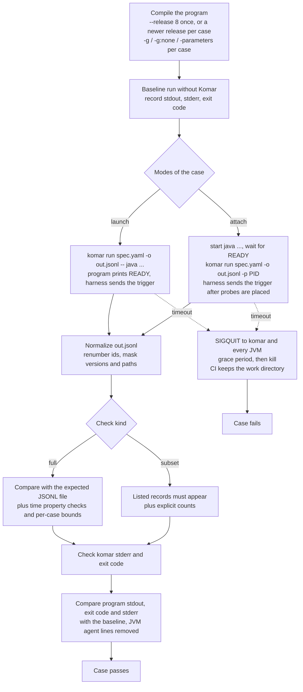

# Komar E2E test suite

**Status:** designed, not implemented. The decisions behind this document were agreed in a design
interview (E-1 to E-21 below), and the case catalog in the appendix is accepted as the MVP's
required set.

**Related documents:**
- Komar's behaviour, which this suite tests: [design overview](../design/README.md),
  [spec language](../design/spec-language.md), [output format](../design/output-format.md),
  [JVM runtime](../design/jvm-runtime.md), [lifecycle and failures](../design/lifecycle-and-failures.md),
  [decisions D-1 to D-46](../design/decisions.md), [scope and roadmap](../design/scope-and-roadmap.md).

`E-n` numbers refer to the decisions of this suite (table in [Decision log](#decision-log)).
`D-n` numbers refer to the MVP design decisions in [decisions.md](../design/decisions.md).

---

## 1. What the suite is and why it is the gate

The E2E suite is a large set of end-to-end test cases. Each case runs the real `komar` binary
against a real Java program and checks what comes out: the JSONL file, stderr and the exit code.
JVM cases run twice, once in launch mode (`komar run spec.yaml -o out.jsonl -- java ...`) and once
in attach mode (`komar run spec.yaml -o out.jsonl -p <pid>`). The suite runs on five JDK versions
on Linux and macOS, and every combination must pass before a change merges.

The suite is **the main correctness gate** for Komar (E-1). This means:

- Every user-visible behaviour of Komar has at least one E2E case that proves it. User-visible
  means anything a user of Komar observes from outside: spec keys, CLI messages, exit codes and
  JSONL records.
- Unit tests are still welcome, for fast feedback and for areas with many combinations, such as
  CEL conformance between cel-go and cel-java and value-encoding edge cases. A unit test never
  replaces the E2E case for a user-visible behaviour.
- Work is test-first: the E2E cases for a behaviour are written first, they fail, and then the
  code is written to make them pass.

Why the gate is end to end: the things that break in practice are exactly what unit tests mock
away. These are agent loading, the attach handshake, the channel between the CLI and the agent,
record framing, and differences between JDK versions and operating systems. The person's words
from the MVP design (D-41): "we surely want TDD approach with many E2E tests with real attaches or
sample progams".

**In one paragraph.** The suite is a `go test` package in a top-level `e2e/` folder. Each case is
one `testscript` file (txtar format) named after its case ID. A JVM case compiles its Java
program, runs it once without Komar as a baseline, runs it under Komar in launch and attach mode,
normalizes the JSONL output and compares it with an expected file. It also checks that the
program's own output and exit code did not change. It runs on Azul Zulu JDK 8, 11, 17, 21 and the
newest GA release, on Linux and macOS. There are no retries: a failure blocks the merge, and a
case that times out leaves stack dumps of every process involved. The required case list holds
315 cases in 12 groups.

---

## 2. How one JVM case runs



Spec-checking cases are simpler. They start no JVM, run `komar` on an invalid spec, and check
stderr, the exit code and that the `-o` file is untouched.

---

## 3. Layout and naming

| Path | Contents |
|---|---|
| `e2e/e2e_test.go` | the Go test entry point that runs every case through `testscript` |
| `e2e/testdata/<case-id>.txtar` | one case per file; the file name is the case ID from the catalog |
| `e2e/programs/<name>/` | bigger Java programs shared by several cases (see [section 4](#4-anatomy-of-a-case)) |

Rules (E-19):

- The case ID in the [catalog](#appendix-required-case-catalog), the name of a failing CI test
  and the file on disk are the same string.
- The first word of a case ID is its group (`spec-`, `method-`, `line-`, `call-`, `value-`,
  `calls-`, `model-`, `rec-`, `life-`, `jvm-`, `limit-`, `err-`, `attach-`, `bc-`). A group is
  selected by its prefix, for example `go test ./e2e -run 'Script/line_'` (the exact run pattern
  depends on how `testscript` names subtests).
- The folder is flat: no subfolders per group.

---

## 4. Anatomy of a case

Each case is one txtar file, run by the `testscript` package from
[go-internal](https://pkg.go.dev/github.com/rogpeppe/go-internal/testscript) (E-2). The file has
two parts:

1. **A script** at the top: one command per line, comments starting with `#`, conditions in
   square brackets such as `[darwin]`.
2. **Embedded files** below, each starting with a `-- name --` line: the Java source, the spec
   and the expected output.

`testscript` gives each case a fresh work directory (`$WORK`), runs commands in the background
with `exec ... &name&`, `wait` and `kill`, shows a diff when files differ, and keeps the work
directory with `-testwork`. Komar adds its own commands to it: run `komar`, run `javac` and `java`
for a chosen JDK, compare JSONL, and wait for a ready line.

> **Command names in the examples are placeholders.** The real names are not decided yet (open
> item O-6).

```text
# line probe sees a local inside a lambda (D-12, D-19)
modes launch attach
javac --release 8 -g -d classes Main.java Ready.java
target java -cp classes Main
komar-run spec.yaml out.jsonl
jsonl-cmp out.jsonl expected.jsonl

-- Main.java --
public class Main {
    public static void main(String[] args) throws Exception {
        Ready.await();                       // prints READY, waits for the trigger
        new Main().run();
    }
    void run() { /* ... a lambda with a local `i` on line 12 ... */ }
}
-- spec.yaml --
probes:
  - id: per_order
    where: { class: Main, method: run, line: [12] }
    what:
      - i: vars.i
-- expected.jsonl --
{"kind":"hit","probe":"per_order","point":"line","what":{"i":0}}
{"kind":"hit","probe":"per_order","point":"line","what":{"i":1}}
```

The expected file shows only `hit` lines here to keep the example short. A real expected file
holds every record of the run (`run`, `diag`, `hit`, `end`) after normalization.

### Programs: inline or shared (E-3)

- **Inline by default.** Small programs, such as a class with one method, a lambda and a
  constructor, live inside their case file. The case reads top to bottom with nothing to open
  elsewhere.
- **Shared for bigger programs.** Programs used by several cases live once in
  `e2e/programs/<name>/` and are referenced by name. Examples: several threads, a task handed to
  an executor, a launcher that starts a second JVM, a long-running attach target.
- A change to a shared program can change the expected output of every case that uses it, so the
  suite keeps a way to list which cases use which shared program. The mechanism is not decided yet
  (O-6).

### Compilation (E-4)

- **Default: compile once with `--release 8`.** One fixed build JDK compiles every program, and
  the same class files run on all five JDKs. Any difference in output then comes from the JVM or
  from the agent, not from the compiler. Programs written this way use only Java 8 language
  features. Which JDK is the build JDK is not decided yet (O-6).
- **Per case: a newer `--release`.** A case may compile with the target JDK's own `javac` and a
  newer `--release`, so the agent also meets newer bytecode shapes: records, `invokedynamic`
  string concatenation, nest-based private access, virtual threads. Such a case is skipped on
  older JDKs.
- **Debug info per case.** Each case states its own `javac` flags: `-g` (all debug info including
  local variables), the default (line numbers and source file only), `-g:none` (nothing) or
  `-parameters` (parameter names). Cases about line probes, `vars` and missing debug info are
  different compile lines over the same source.

```text
# default: built once, runs on every JDK in the matrix
javac --release 8 -g -d classes Main.java

# this case needs JDK 17+ bytecode
[jdk<17] skip
javac --release 17 -d classes Main.java    # for example a record class
```

---

## 5. Assertions and normalization

### Full or subset (E-5)

| Kind | Used for | What it checks |
|---|---|---|
| **full** | every case whose output is predictable: single thread, fixed inputs | the whole JSONL, record by record, against an expected file after normalization; an extra record, a renamed field or a stray `@` marker fails the case |
| **subset** | cases about concurrency, timing and caps | the listed records must appear, with explicit counts; other records may appear |
| **stderr+exit** | spec-checking cases | `komar`'s stderr lines and exit code; the `-o` file is checked as the case states |

An **update mode** rewrites expected files from actual output, so a deliberate format change
shows up as a reviewable diff instead of hundreds of hand edits.

### Fields that vary between runs (E-6)

Before a full comparison, the output is normalized. The goal is to keep checking structure (which
records share a call, which call is inside which, which thread did what) while ignoring values
that differ from run to run or from JDK to JDK.

| Field | Why it varies | How the comparison handles it |
|---|---|---|
| `call`, `parent` | Komar's own counters; any earlier probe shifts them | renumbered in order of first appearance; `call` ids are unique only within one JVM, so they are renumbered per process (`pid`, `call`) |
| `@id`, `@ref` | object identity inside one record | renumbered in order of first appearance |
| `thread.id` | assigned by the JVM; differs across JDKs | renumbered in order of first appearance |
| `pid` | assigned by the OS | renumbered in order of first appearance |
| `thread.name` | default names such as `Thread-3` depend on the JDK | compared exactly, because sample programs name every thread they start |
| `ts` | wall-clock time | not compared as a value; must be a valid ISO-8601 timestamp |
| `t` | nanoseconds since the agent started | not compared as a value; must never decrease on one thread |
| `seq` | write order in the file | not compared as a value; must strictly increase |
| `duration` | milliseconds | not compared as a value; must be ≥ 0; a case may add bounds |
| `run.komar`, `run.jvm`, paths in `run.cmd` | versions and machine paths | masked |
| `run.cmd` vs `run.pid` | launch mode records the command, attach mode the pid | normalization accounts for the difference, so one expected file serves both modes |

**Per-case bounds.** A case may add explicit tolerances on top of the property checks. For
example, a program that sleeps 100 ms can require `duration` ≥ 100.

```text
# actual                                                      normalized
{"call":4812,"parent":null,"thread":{"id":29,"name":"main"}}  {"call":1,"parent":null,"thread":{"id":1,"name":"main"}}
{"call":4815,"parent":4812,"thread":{"id":29,"name":"main"}}  {"call":2,"parent":1,"thread":{"id":1,"name":"main"}}
```

No existing tool was found that normalizes JSONL this way. The closest prior art is snapshot
redaction in insta (unverified).

---

## 6. Launch and attach from one script (E-7)

Every probe feature works in both modes (D-1), and attach is the fragile path: the handshake,
retransforming classes that are already loaded, and detaching. So by default every JVM case runs
in **both** modes from one script and one expected file.

### The ready / trigger protocol

Simply rerunning a launch case with `-p` would not work. A method that is already running when
Komar attaches keeps running the old bytecode, so Komar never sees its entry (D-21). To make both
modes see the same calls, every sample program uses a small shared helper:

1. The program starts and prints a ready line (for example `READY`).
2. It waits for a trigger from the harness.
3. Only then does it call the code being probed.

| Mode | When the harness sends the trigger |
|---|---|
| launch | right away; the agent was loaded at JVM startup |
| attach | after `komar ... -p <pid>` has attached and placed its probes |

Waiting for the ready line also avoids attaching during early JVM startup. Research reported that
the attach signal could crash older JDKs at that moment (JDK-8279124; which updates contain the
fix is not checked, O-7).

### Restricting a case to one mode

A case that only makes sense in one mode says so in its script. This is visible in review.

| Restriction | Examples |
|---|---|
| launch only | several JVMs started by one command (D-27); `stop` ending the program it launched (D-28) |
| attach only | methods already running when Komar attaches show up as roots (D-21); detach restores the original code (D-29); re-attach; the JEP 451 warning |
| no JVM | spec-checking cases; the mode question does not arise |

### The JEP 451 warning

On JDK 21 and later, loading an agent into a running JVM prints a warning on the **target's**
stderr unless the target was started with `-XX:+EnableDynamicAgentLoading`. The text starts with
"WARNING: A Java agent has been loaded dynamically (<path>)" (checked in
`InstrumentationImpl.java` at `jdk-21-ga`). Launch mode prints no such warning. The no-behaviour
check removes these lines ([section 7](#7-the-komar-does-not-change-the-program-check)), and
attach cases test the warning itself with and without the flag.

---

## 7. The "Komar does not change the program" check

Komar must not change the program it observes (D-13, D-41). The suite checks this on every JVM
case.

### What is compared (E-11)

Each checked case runs the program once **without** Komar as a baseline, then under Komar:

| Stream | Rule |
|---|---|
| program stdout | identical, byte for byte |
| program exit code | identical |
| program stderr | identical after removing an exact, short list of lines the JVM itself prints when an agent loads |

The JVM lines removed from stderr:

| Mode | Lines | Source |
|---|---|---|
| launch | `Picked up JAVA_TOOL_OPTIONS: ...` | HotSpot `arguments.cpp` (research only, unverified) |
| attach, JDK 21+ | the JEP 451 block starting "WARNING: A Java agent has been loaded dynamically (<path>)" | `InstrumentationImpl.java` at `jdk-21-ga` (checked) |

The list matches exactly. If a JDK changes its wording, the stale entry fails loudly instead of
silently hiding other output.

**Exemptions.** Two kinds of run change the program on purpose, so they are not compared:

- probes with `calls: true`, because the spec explicitly asks Komar to run program code (D-13,
  D-14);
- launch-mode runs ended by `stop`, because Komar then terminates the program it started (D-28).

### Which cases run it (E-12)

- **Every JVM case, by default.** Nothing has to be written in the case to get the check.
- **One baseline per case** for each JDK × OS combination, reused for launch and attach, since
  the program is identical in both modes.
- **Opt-out with a reason.** A case whose program output is genuinely non-deterministic (thread
  interleaving, timing) opts out with a line that states why, for example
  `no-baseline 'thread interleaving changes program stdout'` (placeholder). Reviewers see every
  opt-out. Whether the suite also reports or limits the number of opt-outs is not decided (O-6).

---

## 8. Matrix and merge gate

### Twenty combinations, all blocking (E-8)

| | launch | attach |
|---|---|---|
| Linux, JDK 8 | ✔ | ✔ |
| Linux, JDK 11 | ✔ | ✔ |
| Linux, JDK 17 | ✔ | ✔ |
| Linux, JDK 21 | ✔ | ✔ |
| Linux, newest GA | ✔ | ✔ |
| macOS, JDK 8 | ✔ | ✔ |
| macOS, JDK 11 | ✔ | ✔ |
| macOS, JDK 17 | ✔ | ✔ |
| macOS, JDK 21 | ✔ | ✔ |
| macOS, newest GA | ✔ | ✔ |

Every pull request must pass the full suite on all 20 combinations before it merges. CI splits
the work into parallel jobs, at least one per OS and JDK; the exact split is not decided (O-6).
The rare combinations are exactly where Komar is most likely to break: attach differences on
macOS and retransformation on Java 8.

**Run time is not measured yet.** A research estimate put about 6,000 runs (300 cases × 20
combinations) at 1–2.5 hours if run one after another, and minutes per job when split. If the
measured time turns out too long, E-8 is the decision to revisit (O-8).

### JDK builds: Azul Zulu everywhere (E-9)

All combinations run on Azul Zulu builds of OpenJDK, so the vendor never differs between cells.
A failure on one cell is about the JDK version, the OS or the mode, not the vendor. All Zulu
builds are HotSpot, which matches Komar's supported targets (D-4).

Why not Temurin: Temurin has no Java 8 build for macOS on Apple Silicon. The Adoptium API returns
nothing for 8 on macOS arm64 (checked). Zulu has every needed build (Azul metadata API, queried
2026-10-09):

| JDK | Zulu build | macOS arm64 | macOS x64 | Linux x64 |
|---|---|---|---|---|
| 8 | 8.0.504 | ✔ | ✔ | ✔ |
| 11 | 11.0.32.1 | ✔ | ✔ | ✔ |
| 17 | 17.0.20.1 | ✔ | ✔ | ✔ |
| 21 | 21.0.12.1 | ✔ | ✔ | ✔ |
| 25 | 25.0.4.1 | ✔ | ✔ | ✔ |
| 26 | 26.0.2.1 | ✔ | ✔ | ✔ |
| 27 | 27.0.0 | ✔ | ✔ | ✔ |

Linux arm64 was not checked (O-7); the matrix says "Linux" without an architecture. The exact
Zulu versions are pinned in the CI configuration.

### "Current" means the newest GA release (E-10)

The fifth JDK is the newest general-availability release: JDK 27 at the time of writing. When a
new GA ships, CI moves to it in a one-line change to the pinned version, and that change must pass
the full suite before it merges. JDK 21 stays as a fixed cell. JDK 25 (the latest long-term
support release at the time of writing) has no permanent cell of its own.

---

## 9. Local development (E-14)

A developer working test-first cannot wait for 20 combinations on every edit, so the suite has
two local modes.

| Mode | What runs | Use |
|---|---|---|
| short tier | `go test ./e2e -short`: every case on the local default JDK, skipping cases marked slow | the everyday TDD loop |
| one CI cell | any JDK × mode combination the machine can host, with a mapping of versions to installed JDKs | reproducing a CI failure exactly |

```text
go test ./e2e -short
KOMAR_E2E_JDKS='8=/opt/zulu8,21=/opt/zulu21' \
  go test ./e2e -run 'Script/line_.*' -jdk=8 -mode=attach
```

The variable, the flags and the run pattern are placeholders (O-6). Which cases count as slow is
not decided. A cell for an OS other than the developer's own can only run in CI.

---

## 10. Failures

### No retries, no quarantine (E-15)

A failing case blocks the merge, every time. The suite has no automatic retry and no quarantine
list. An intermittent case must be fixed, or the case itself corrected, before work merges.

The person chose this over the recommended quarantine (answer: "a"). The reasoning behind it:
Komar's hardest bugs, such as races in the attach handshake, per-thread call tracking and the
CLI channel, look exactly like flakiness. Retries would hide them in the gate. Other projects do
retry (OpenTelemetry up to 5 times on CI) or move flaky tests to a non-blocking job (Datadog);
both are unverified research findings.

### What a stuck case leaves behind (E-16)

With no retries, one failed run must be enough to debug.

| Failure | What the harness does | What remains |
|---|---|---|
| timeout | sends SIGQUIT to `komar` (Go prints all goroutine stacks) and to every JVM the case started or attached to (HotSpot prints a thread dump); waits a grace period; then kills them | the case's work directory, uploaded by CI: spec, `out.jsonl`, stdout, stderr and the dumps |
| wrong output or exit code | reports the comparison diff | the diff and the captured output |

Details:

- A HotSpot JVM treats SIGQUIT as an attach request when an `.attach_pid` file is present. The
  harness makes sure none is lying around before it sends the dump signal.
- Go's own `cmd/go` script tests handle timeouts the same way: signal, grace period, kill
  (checked in `script_test.go` at go1.23.0).
- Timeout and grace values are set after measuring real cases (O-6).
- Komar has no debug log in the MVP design, so none is collected.

---

## 11. Coverage

### Coverage is reviewed by people, for now (E-13)

There are no machine-checked links from cases to the behaviours they prove in the first version.
Reviewers judge whether each user-visible behaviour has an E2E case, using the design decisions
(`D-n`, `E-n`) and the [required-case catalog](#appendix-required-case-catalog). The person's answer
was "c for now". Machine-checked links (a `covers:` line in each case naming the decisions it
proves, and a check that fails on gaps) may come later (O-2).

### The required list is the definition of done (E-17)

The MVP is not done until every case in the [catalog](#appendix-required-case-catalog) exists and
passes on all 20 combinations.

- The list aims at about 300 cases. The person: "lets drop rare stuff and try to cover more
  cases. lets aim on 300 really".
- "Rare stuff" means cases that need capabilities CI runners rarely have: a second OS user, a
  container runtime, root, Windows, OpenJ9 or network access. They are not in the list.
- Every case must prove an observable behaviour no other case proves. Near-duplicates are not
  added just to reach a number.
- The list grows as new cases are found.
- The person accepted the list as written: "i accept everything".

The catalog has 315 cases in 12 groups:

| Group | Cases |
|---|---|
| Spec checking without a JVM | 31 |
| Method probes | 50 |
| Line probes | 23 |
| Call-site probes | 25 |
| Values and expressions | 64 |
| Opt-in method calls | 12 |
| Call model | 18 |
| Records and lifecycle | 37 |
| Several JVMs | 10 |
| Limits and runtime errors | 15 |
| Attach and targets | 14 |
| Bytecode variants | 16 |
| **Total** | **315** |

---

## 12. Overhead benchmark (E-20)

The MVP design includes a per-hit overhead benchmark (D-41). It is **outside the merge gate**. It
does not run on every merge, only nightly or on request. A slowdown is therefore found after the
change that caused it has merged.

The benchmark produces the first real numbers for the defaults nobody has measured yet:
`call_ms`, `max_hits`, `classes` and the capture limits (D-23, D-31, D-34).

---

## 13. Changes this design makes elsewhere

One decision here changes documents outside this one. **Those documents are not updated yet.**

| Change | Decision | Documents still showing the old text |
|---|---|---|
| The class cap is enforced by the agent at run time. When a `where` pattern matches more classes than `limits.classes`, the agent removes that probe everywhere, places no more of it, and writes one `diag` with the match count. Other probes keep recording, and hits recorded before stay in the file. This replaces D-34's "spec error before launch": the CLI never sees the program's classes, so it cannot count them before launch. | E-18 | [spec-language.md](../design/spec-language.md), [lifecycle-and-failures.md](../design/lifecycle-and-failures.md) (O-4) |

---

## 14. Non-goals (E-21)

**Not in the suite, by decision**

| Item | Why | Decision |
|---|---|---|
| Agent-task evaluation (an AI agent finding seeded bugs) | postponed; the stated target, not part of the MVP gate | D-41 |
| Overhead thresholds in the merge gate | the benchmark runs nightly or on request | E-20 |
| Retries and quarantine | a failure always blocks | E-15 |
| Machine-checked links from cases to the decisions they prove | review only, "for now" | E-13 |
| JDK vendors other than Zulu | one vendor everywhere; several vendors could become a later non-blocking job | E-9 |
| JDK 25 (LTS) as a permanent cell | "current" means the newest GA release | E-10 |

**Not in the suite, because the MVP does not support it or runners lack it**

| Item | Why | Decision |
|---|---|---|
| Windows, OpenJ9, GraalVM native image | not MVP targets | D-4 |
| Attach as another OS user; targets in another container | need runner capabilities CI rarely has | E-17 follow-up |
| Linux on arm64 | not in the matrix; Zulu not checked for it | E-9 |
| Python and other runtimes | not in the MVP | MVP scope |

**Never discussed**, listed so their absence is explicit: fuzzing the spec parser, mutation
testing, multi-hour soak runs.

---

## 15. Open items

| # | Item | Why it is open | What it affects |
|---|---|---|---|
| O-1 | No longer applies | it concerned a separate spec-writing process, which was dropped; the number is kept so O-2 to O-8 stay stable | — |
| O-2 | When to add machine-checked links from cases to the decisions they prove | review only "for now" (E-13), no trigger set | enforcement of E-1 by tooling |
| O-3 | Refusing to attach to another user's JVM (D-4) and to a target in another container (D-38) have no E2E case | those cases need rare runner capabilities and were dropped | E-1 coverage of these two behaviours |
| O-4 | The design docs still describe the class cap as a spec error before launch | E-18 not carried over yet | consistency of `docs/design/` |
| O-6 | Implementation details: script command names; the build JDK for `--release 8`; how shared programs list the cases that use them; which cases are slow; timeout and grace values; CI job split; whether baseline opt-outs are reported or limited | left to implementation | the harness |
| O-7 | Facts not checked: Zulu on Linux arm64; which JDK 8 / 11 / 17 updates contain the JDK-8279124 fix; whether `$TMPDIR` matches the JVM attach directory on GitHub macOS runners; thread id stability across JDKs; real run time per case | needs an experiment or more research | E-8 run time, E-6 details |
| O-8 | Run time of the full matrix | only a research estimate (about 1–2.5 h serial for 6,000 runs) | E-8 may need revisiting |

O-5 (accepting the case catalog) is closed: the person accepted it ("i accept everything").

**Facts worth knowing when implementing** (checked unless marked):

- On macOS, HotSpot puts its attach socket in the per-user temp directory from
  `confstr(_CS_DARWIN_USER_TEMP_DIR)`, not in `java.io.tmpdir` (checked in `os_bsd.cpp` at
  `jdk-21-ga`). An attach case on a macOS runner catches a client that looks in the wrong place.
- On Linux, the attach files live in `/tmp` (research, unverified).
- The JDK's own attach client polls for up to 10 s (research, unverified).
- Thread ids and default thread names differ across JDK versions (research, unverified); this is
  why ids are renumbered and threads are named.
- One class-file set compiled with `--release 8` runs on JDK 8 through current (research,
  inferred, unverified).
- `javac --release` supports "the current Java SE release and a limited number of previous
  releases" (checked in javac(1), JDK 25). Release 7 was dropped in JDK 20 (research, unverified),
  so 8 may be dropped one day; the build JDK would then be pinned.

---

## Decision log

These are the decisions behind the suite. The answers are the person's own words.

| ID | Topic | Decision | Answer |
|---|---|---|---|
| E-1 | What the gate means | Every user-visible behaviour (spec keys, CLI messages, exit codes, JSONL records) is proved by at least one E2E case; unit tests allowed in addition, never as the only proof; test-first | "b" |
| E-2 | Case format | One `testscript` / txtar file per case | "a" |
| E-3 | Where programs live | Inline by default; bigger programs shared in one folder | "b" |
| E-4 | Compilation | `--release 8` once by default; a newer `--release` per case with the target JDK's javac; debug flags per case | "c" |
| E-5 | JSONL assertions | Full expected file by default; subset with counts for timing and concurrency cases; update mode | "с" (read as c) |
| E-6 | Varying fields | Renumber ids; check time properties; per-case bounds; mask versions and paths; compare thread names exactly | "c" |
| E-7 | Modes | Every JVM case runs in launch and attach from one script via a ready / trigger helper; a case may restrict itself to one mode | "с" (read as c) |
| E-8 | Merge gate | All 20 JDK × OS × mode combinations block every merge | "a" |
| E-9 | JDK vendor | Azul Zulu for all combinations | "a" |
| E-10 | "Current" JDK | The newest GA release | "a" |
| E-11 | No-behaviour check: what | stdout and exit code identical; stderr identical after removing an exact list of JVM agent lines | "b" |
| E-12 | No-behaviour check: which cases | Every JVM case by default; one baseline shared by both modes; opt-out with a reason | "c" |
| E-13 | Coverage tracking | Review only against the decisions and the required-case catalog; no machine links | "c for now" |
| E-14 | Local development | Short tier on the default JDK, plus any CI cell selectable locally | "c" |
| E-15 | Intermittent failures | No retries, no quarantine | "a" |
| E-16 | Stuck cases | Timeout, SIGQUIT dumps of `komar` and every JVM, grace period, kill, work directory kept | "b" |
| E-17 | Required coverage | A required case list per group; aims at about 300; no rare runner capabilities; accepted as written | "b"; then "lets drop rare stuff and try to cover more cases. lets aim on 300 really"; then "i accept everything" |
| E-18 | Class cap (changes D-34) | Enforced by the agent at run time: the probe is switched off with one `diag` | "b" |
| E-19 | Layout | Top-level `e2e/`, flat, file name equals case ID | "a" |
| E-20 | Overhead benchmark | Outside the merge gate; nightly or on request | "с" (read as c) |
| E-21 | Non-goals | The list in [section 14](#14-non-goals-e-21) | "looks right" |

Three answers were typed with the Cyrillic letter "с" and were read as option c.

---

## Appendix: required case catalog

This is the full list of required cases (E-17), accepted by the person as written. The MVP is
done when every case exists and passes on all 20 combinations.

**Column key**

- **ID**: the case ID; also the file name `e2e/testdata/<ID>.txtar`.
- **What the case proves**: the observable behaviour, in one line.
- **Proves**: the MVP decisions (`D-n`, see [decisions.md](../design/decisions.md)) and suite
  decisions (`E-n`) the case proves.
- **Modes**: `both` = launch and attach from one script (E-7); `launch` / `attach` = restricted to
  one mode; `no JVM` = spec checking only, nothing is started.
- **Check**: `full` = whole expected JSONL after normalization (E-5, E-6); `subset` = listed
  records plus explicit counts; `stderr+exit` = stderr lines and exit code, with the `-o` file
  checked as stated. The baseline comparison (E-11, E-12) runs for every JVM case unless the cell
  says `no baseline` with the reason.
- **(proposal)**: the case tests a part of the MVP design that is still a proposal. Examples are
  the version marker, the `<init>` alias, default limit values, and the exact JSON form of some JDK
  types. The case is accepted as written and asserts the behaviour as listed. If implementation
  settles the proposal differently, the case is updated together with `docs/design/`.
- **(reading)**: the case tests an interpretation of an MVP decision that the decision did not
  state explicitly. It is accepted as written and asserts the behaviour as listed. If
  implementation settles the point differently, the case is updated together with `docs/design/`.
- Not included: cases that need a second OS user, a container runtime, root, Windows, OpenJ9 or
  network access (E-17).

#### 1. Spec checking without a JVM

| ID | What the case proves | Proves | Modes | Check |
|---|---|---|---|---|
| `spec-unknown-key-suggestion` | `wher:` in a probe is reported as `komar: spec.yaml:L:C: ...` with a "did you mean `where`" suggestion; exit 2 | D-33, D-32 | no JVM | stderr+exit |
| `spec-unknown-top-level-key` | an unknown top-level key is an error with its position | D-33 | no JVM | stderr+exit |
| `spec-unknown-point-suggestion` | `at: [enter]` is an error suggesting `entry` | D-5, D-33 | no JVM | stderr+exit |
| `spec-yaml-syntax-error` | malformed YAML is reported with line and column; exit 2 | D-33 | no JVM | stderr+exit |
| `spec-cel-yaml-tag` | an unquoted `when: !vars.ok` is reported as a YAML error at its position, not silently mis-parsed | D-33 | no JVM | stderr+exit |
| `spec-all-errors-at-once` | a spec with three different errors reports all three plus a count line, in one run | D-33 | no JVM | stderr+exit |
| `spec-error-format` | every message has the shape `komar: <file>:<line>:<col>: <message>`, lowercase, with no trailing period | D-33 | no JVM | stderr+exit |
| `spec-output-untouched` | with an existing `out.jsonl`, an invalid spec leaves it byte-identical | D-33, D-32 | no JVM | stderr+exit; `-o` file unchanged |
| `spec-nothing-started-launch` | an invalid spec with `-- java Main` never starts the program (the program would create a marker file; none exists) | D-33 | no JVM | stderr+exit |
| `spec-nothing-attached` | an invalid spec with `-p <pid>` of a running target does not attach: the target's stdout and stderr are unchanged and later calls produce no records | D-33 | attach | stderr+exit |
| `spec-missing-id` | a probe without `id` is an error (reading) | D-33 | no JVM | stderr+exit |
| `spec-duplicate-probe-id` | two probes with the same `id` are an error (reading) | D-33 | no JVM | stderr+exit |
| `spec-missing-where` | a probe without `where` is an error (reading) | D-2, D-33 | no JVM | stderr+exit |
| `spec-where-incomplete` | a `where` without `class`, and one without `method`, are errors (reading) | D-2, D-33 | no JVM | stderr+exit |
| `spec-at-on-line-probe` | `at:` together with `line:` is an error | D-8 | no JVM | stderr+exit |
| `spec-wrong-point-method` | `at: [before]` on a method probe is an error | D-8, D-9 | no JVM | stderr+exit |
| `spec-wrong-point-call` | `at: [entry]` on a call-site probe is an error | D-8, D-9 | no JVM | stderr+exit |
| `spec-mixed-kinds` | a probe with both `line:` and `call:` is an error | D-8 | no JVM | stderr+exit |
| `spec-params-malformed` | `params: ['List<']` is an error with its position (reading) | D-7 | no JVM | stderr+exit |
| `spec-key-wrong-type` | a key with a value of the wrong type (`calls: "yes"`, `subtypes: maybe`) is an error (reading) | D-6, D-14, D-33 | no JVM | stderr+exit |
| `spec-cel-syntax-when` | a CEL syntax error in `when` is reported before launch | D-15, D-33 | no JVM | stderr+exit |
| `spec-cel-syntax-what` | a CEL syntax error in a `what` item is reported before launch | D-15, D-33 | no JVM | stderr+exit |
| `spec-cel-type-error` | `when: 'duration > "100"'` fails the CEL type check before launch | D-15, D-43 | no JVM | stderr+exit |
| `spec-when-not-bool` | `when: '1 + 2'` is rejected because a condition must be boolean | D-15 | no JVM | stderr+exit |
| `spec-call-without-flag-when` | `args[0].getTotal() > 1` in `when` without `calls: true` is an error naming the flag | D-14 | no JVM | stderr+exit |
| `spec-call-without-flag-what` | `args[0].toString()` in `what` without `calls: true` is an error naming the flag | D-14 | no JVM | stderr+exit |
| `spec-bare-program-name` | `when: 'order.total > 1'` (no `vars.`) is an undeclared-reference error | D-19 | no JVM | stderr+exit |
| `spec-duplicate-what-keys` | two `what` items with the same output key are an error (proposal) | D-16 | no JVM | stderr+exit |
| `spec-hits-in-limits` | `limits: { hits: 50 }` is an error suggesting `max_hits` | D-44 | no JVM | stderr+exit |
| `spec-max-hits-in-stop` | `stop: { max_hits: 500 }` is an error suggesting `hits` | D-44 | no JVM | stderr+exit |
| `spec-version-unsupported` | `version:` with a value the CLI does not implement is an error (proposal) | D-46 | no JVM | stderr+exit |

#### 2. Method probes

| ID | What the case proves | Proves | Modes | Check |
|---|---|---|---|---|
##### Points

| ID | What the case proves | Proves | Modes | Check |
|---|---|---|---|---|
| `method-entry-exit` | entry carries `args`, exit carries `ret`; both records share one `call` and are written as they happen | D-2, D-5, D-26 | both | full |
| `method-exception` | an exception exit writes `point: exception` with `exception`; the program sees the same exception (baseline stdout and exit code match) | D-2, D-5, D-17 | both | full |
| `method-points-entry-only` | `at: [entry]` writes entry records only | D-5 | both | full |
| `method-points-exit-only` | `at: [exit]` writes exit records only, also when the method throws (no record then) | D-5 | both | full |
| `method-points-exception-only` | `at: [exception]` writes only for calls that throw | D-5 | both | full |
| `method-entry-record-before-hang` | a method that blocks forever (until the case ends it) has its entry record in the file before the run ends | D-5 | both | subset; no baseline (program is ended by the harness) |
| `method-void-exit` | a `void` method's exit record has no `ret` key | D-17 | both | full |
| `method-return-primitive` | `ret` of an `int` method is a JSON number | D-22 | both | full |
| `method-many-returns` | a method with several `return` statements writes exit on each path with the right `ret` | D-5 | both | full |
| `method-exception-rethrown-same` | the exception the program catches after the probed method is the same object (identity check printed by the program; baseline matches) | D-5, D-9 | both | full |

##### Exceptions

| ID | What the case proves | Proves | Modes | Check |
|---|---|---|---|---|
| `method-exception-checked` | a checked exception (`IOException`) is recorded with its type and message | D-5 | both | full |
| `method-exception-unchecked` | a runtime exception is recorded | D-5 | both | full |
| `method-exception-error` | an `Error` subclass (e.g. `AssertionError`) is recorded at the exception point | D-5 | both | full |
| `method-exception-from-callee` | an exception thrown in an unprobed callee and passing through M records an exception exit for M | D-5 | both | full |
| `method-exception-caught-inside` | an exception thrown and caught inside M produces a normal exit, no exception record | D-5 | both | full |
| `method-exception-wrapped` | an exception caught and rethrown wrapped records the wrapper type, with its cause captured in `exception` | D-5, D-22 | both | full |
| `method-exception-in-constructor` | a constructor that throws records `point: exception` on `method: new` | D-11 | both | full |

##### Where-matching

| ID | What the case proves | Proves | Modes | Check |
|---|---|---|---|---|
| `method-class-exact` | an exact class name matches that class only, not a same-named class in another package | D-6 | both | full |
| `method-class-wildcard` | `class: 'com.shop.*Service'` matches two classes and no others | D-6 | both | full |
| `method-name-wildcard` | `method: 'get*'` matches every getter-named method and not others | D-6 | both | full |
| `method-subtypes-optin` | an interface with `subtypes: true` matches every implementation, including one loaded after probes are placed | D-6 | both | full |
| `method-subtypes-superclass` | a base class with `subtypes: true` matches overriding methods in subclasses | D-6 | both | full |
| `method-interface-no-subtypes` | the same interface without `subtypes` matches no code; a `diag` reports it | D-6, D-24 | both | full |
| `method-default-interface-method` | a default method of an interface, named on the interface, fires | D-6 | both | full |
| `method-static` | a static method fires; `this` is absent from its records | D-2, D-17 | both | full |
| `method-private` | a private method fires | D-2 | both | full |
| `method-synchronized` | a synchronized method fires; the program's lock behaviour is unchanged (baseline matches) | D-2 | both | full |
| `method-nested-static-class` | `class: Outer$Inner` matches a static nested class (reading: binary name) | D-6 | both | full |
| `method-inner-class` | an inner (non-static) class method fires | D-6 | both | full |
| `method-class-loaded-late` | a class first loaded after probes are placed is instrumented when it loads | D-6 | both | full |
| `method-custom-classloader` | a class loaded by a custom class loader in the program is matched | D-6 | both | full |
| `method-bridge-not-duplicated` | a generic override producing a bridge method writes one record per call, not two | D-7 | both | full |

##### Overloads and params

| ID | What the case proves | Proves | Modes | Check |
|---|---|---|---|---|
| `method-overloads-all` | no `params` probes every overload; each hit's `method` names the overload that ran | D-7 | both | full |
| `method-params-qualified` | `params: [java.lang.String, int]` selects exactly one overload | D-7 | both | full |
| `method-params-simple-name` | `params: [String, int]` selects the same overload by simple names | D-7 | both | full |
| `method-params-ambiguous-simple` | `params: [Date]` probes both the `java.util.Date` and `java.sql.Date` overloads | D-7 | both | full |
| `method-params-empty-list` | `params: []` selects only the no-argument overload | D-7 | both | full |
| `method-params-primitive-vs-boxed` | `params: [int]` and `params: [Integer]` select different overloads | D-7 | both | full |
| `method-params-array` | `params: ['byte[]']` and `params: ['String[][]']` select array overloads | D-7 | both | full |
| `method-params-generics` | `params: ['List<Order>']` matches the erased `List` parameter | D-7 | both | full |
| `method-params-varargs` | `params: [String, Object...]` matches the varargs overload | D-7 | both | full |
| `method-params-type-variable` | `params: [K, V]` matches a generic method through its `Signature` attribute | D-7 | both | full |
| `method-params-type-variable-stripped` | with the `Signature` attribute absent, `params: [K]` matches nothing and is reported | D-7, D-24 | both | full |
| `method-params-no-match` | `params` that match no overload place nothing and a `diag` reports it | D-7, D-24 | both | full |

##### Constructors and lambdas

| ID | What the case proves | Proves | Modes | Check |
|---|---|---|---|---|
| `method-constructor-new` | `method: new` with `at: [exit]` captures the constructed `this` | D-11, D-42 | both | full |
| `method-constructor-entry-args` | `method: new` at `entry` captures `args` | D-11 | both | full |
| `method-constructor-overload` | `method: new` plus `params` selects one constructor | D-7, D-11 | both | full |
| `method-constructor-chain` | a constructor calling `this(...)` and `super(...)` writes one exit record per constructor invoked | D-11 | both | full |
| `method-constructor-init-alias` | `method: <init>` behaves like `method: new` (proposal) | D-42 | both | full |
| `method-lambda-body-not-included` | a method probe on M does not fire for lambda bodies declared in M (reading) | D-12 | both | full |

#### 3. Line probes

| ID | What the case proves | Proves | Modes | Check |
|---|---|---|---|---|
| `line-locals-with-g` | with `-g`, `vars.i` at the line has the loop value on each hit | D-2, D-8, D-19 | both | full |
| `line-locals-without-g` | with default javac, `vars.i` is absent from the records and a `diag` names the missing debug info as the reason | D-17, D-19 | both | full |
| `line-params-parameters-flag` | with `-parameters` only, `vars.<param>` is present and `vars.<local>` is absent | D-19 | both | full |
| `line-no-line-table` | with `-g:none`, the line probe cannot be placed; a `diag` says why; other probes still record | D-2, D-24 | both | full |
| `line-multiple-lines` | `line: [51, 57]` writes records for both lines, each naming its line | D-8 | both | full |
| `line-in-loop-each-iteration` | a line inside a loop writes one record per iteration | D-8 | both | full |
| `line-not-executed` | a line on an untaken branch writes no records and the probe is still reported as placed | D-8, D-24 | both | full |
| `line-blank-or-comment` | a line with no code (blank or comment) places nothing and a `diag` reports it | D-8, D-24 | both | full |
| `line-local-not-yet-in-scope` | `vars.x` on a line before `x` is declared is absent from the record | D-17, D-19 | both | full |
| `line-local-out-of-scope` | `vars.x` after the block declaring `x` has ended is absent | D-17, D-19 | both | full |
| `line-sees-args-and-this` | `args` and `this` are available at a line point | D-19, D-20 | both | full |
| `line-no-ret` | `ret` in `what` at a line point is omitted | D-17 | both | full |
| `line-when-on-local` | `when: 'vars.i % 2 == 0'` filters line hits by a local value | D-15, D-19 | both | full |
| `line-in-constructor` | a line inside a constructor fires | D-8, D-11 | both | full |
| `line-in-static-method` | a line inside a static method fires with no `this` | D-8, D-17 | both | full |
| `line-in-catch-block` | a line inside a `catch` block fires only when the exception is caught | D-8 | both | full |
| `line-in-finally-block` | a line inside `finally` fires on both the normal and the exceptional path | D-8 | both | full |
| `line-in-nested-lambda` | a line in a lambda nested in another lambda in M fires | D-12 | both | full |
| `line-in-lambda` | a line inside `forEach(o -> ...)` in M fires per element; `method` names the lambda body, the record also names M | D-12 | both | full |
| `line-in-anonymous-class` | a line inside an anonymous class declared in M fires | D-12 | both | full |
| `line-in-local-class-loaded-later` | a line in a local class that loads after placement still fires | D-12 | both | full |
| `line-not-in-method` | a line number outside M places nothing and a `diag` reports it | D-12, D-24 | both | full |
| `line-carries-enclosing-call` | a line record carries the `call` of the enclosing invocation even though no method probe is defined | D-21 | both | full |

#### 4. Call-site probes

| ID | What the case proves | Proves | Modes | Check |
|---|---|---|---|---|
| `call-before-after` | `before` carries `call.args`; `after` carries `ret` and `duration` | D-8, D-9, D-20, D-43 | both | full |
| `call-exception` | a callee that throws writes `point: exception`; the program sees the same exception | D-9 | both | full |
| `call-runtime-class-exact` | with two implementations, `class: StripeGateway` matches only calls landing on that class | D-10 | both | full |
| `call-runtime-class-subtypes` | `class: PaymentGateway, subtypes: true` matches calls landing on either implementation | D-10 | both | full |
| `call-static` | a static call is matched by the class named in the call | D-10 | both | full |
| `call-interface-no-subtypes-warning` | an interface target without `subtypes` produces a warning `diag` and no hits | D-10 | both | full |
| `call-this-vs-target` | `this` is the caller, `call.target` the receiver, and a program parameter named `call` is `vars.call` | D-19, D-20 | both | full |
| `call-inside-lambda` | a call site inside a lambda declared in M fires | D-12 | both | full |
| `call-jdk-callee` | a call to a JDK method (e.g. `java.util.Map.get`) is observed without instrumenting the JDK class | D-2 | both | full |
| `call-before-only` | `at: [before]` writes before records only | D-9 | both | full |
| `call-after-only` | `at: [after]` writes nothing for a callee call that throws | D-9 | both | full |
| `call-exception-only` | `at: [exception]` writes only for throwing calls | D-9 | both | full |
| `call-exception-checked` | a checked exception from the callee is recorded and rethrown unchanged | D-9 | both | full |
| `call-exception-caught-by-caller` | the caller catching the callee's exception still gets an exception record at the call site, and its own exit is normal | D-9 | both | full |
| `call-same-callee-twice` | two calls to the same callee in one method each write their own records | D-8 | both | full |
| `call-in-loop` | a call inside a loop writes one before/after pair per iteration | D-8 | both | full |
| `call-receiver-subclass-exact-miss` | `class: Base` without `subtypes` does not match a call whose receiver is a `Sub` | D-10 | both | full |
| `call-receiver-mixed` | in one loop over mixed receivers, only calls landing on the named class fire | D-10 | both | full |
| `call-params-overload` | `call: { ..., params: [int] }` selects one callee overload | D-7, D-10 | both | full |
| `call-params-absent-all-overloads` | a call target without `params` matches calls to every overload | D-7, D-10 | both | full |
| `call-inside-anonymous-class` | a call site inside an anonymous class declared in M fires | D-12 | both | full |
| `call-callee-not-instrumented` | a call-site probe alone writes no method-probe records for the callee | D-8 | both | full |
| `call-duration-after` | `duration` at `after` measures the call, at least the callee's sleep time | D-43 | both | full; per-case bound |
| `call-ret-void-callee` | `after` of a void callee has no `ret` key | D-17 | both | full |
| `call-target-absent-static` | `call.target` in `what` on a static call is omitted | D-17, D-20 | both | full |

#### 5. Values and expressions

| ID | What the case proves | Proves | Modes | Check |
|---|---|---|---|---|
##### Reading rule

| ID | What the case proves | Proves | Modes | Check |
|---|---|---|---|---|
| `value-private-fields-no-getter` | `what: [this.total]` reads a private field; a getter with a visible side effect is never called (baseline stdout matches) | D-13 | both | full |
| `value-tostring-never-called` | capturing an object whose `toString()` prints to stdout leaves stdout unchanged (baseline matches) | D-13 | both | full |
| `value-inherited-fields` | an object's captured fields include fields declared in its superclass (reading) | D-13, D-22 | both | full |
| `value-type-marker` | a program object carries `@type` with its runtime class name | D-22 | both | full |
| `value-runtime-type-not-declared` | an `Object`-typed argument holding a `HashMap` renders as a map | D-13, D-22 | both | full |
| `value-secrets-verbatim` | a field named `password` is captured as is, with no redaction | D-35 | both | full |

##### Primitives and simple JDK types

| ID | What the case proves | Proves | Modes | Check |
|---|---|---|---|---|
| `value-primitives` | `boolean`, `byte`, `short`, `int`, `float`, `double` render as JSON booleans and numbers | D-22 | both | full |
| `value-char` | a `char` renders as a one-character string (proposal) | D-22 | both | full |
| `value-boxed` | boxed `Integer`, `Long`, `Double`, `Boolean` render like their primitives | D-13 | both | full |
| `value-large-long` | a `long` outside +/-2^53 is written as a decimal string | D-22 | both | full |
| `value-nan-infinity` | `NaN` and infinities render in a valid JSON form (proposal: exact form) | D-22 | both | full |
| `value-string-unicode` | a string with non-ASCII and emoji characters round-trips correctly | D-22 | both | full |
| `value-string-control-chars` | a string with newlines, quotes and control characters is valid escaped JSON | D-22, D-24 | both | full |
| `value-big-decimal` | `BigDecimal` renders without losing digits (proposal: exact form) | D-13, D-22 | both | full |
| `value-big-integer` | `BigInteger` beyond 2^63 renders without losing digits (proposal: exact form) | D-13, D-22 | both | full |
| `value-java-time` | `Instant`, `LocalDate`, `Duration` render as JDK values, not field graphs (proposal: exact form) | D-13 | both | full |
| `value-enum` | an enum constant renders by its name (proposal: exact form) | D-13 | both | full |
| `value-null-vs-absent` | `ret` is a real `null` at exit of a method returning null, and absent at entry | D-17 | both | full |
| `value-null-field` | a field holding `null` appears as `null`, not omitted | D-17, D-22 | both | full |

##### Arrays and collections

| ID | What the case proves | Proves | Modes | Check |
|---|---|---|---|---|
| `value-array-primitive` | an `int[]` renders as a JSON array | D-13 | both | full |
| `value-array-object` | an `Order[]` renders as an array of objects | D-13 | both | full |
| `value-array-nested` | an `int[][]` renders as nested arrays | D-13 | both | full |
| `value-byte-array` | a `byte[]` renders in its decided form (proposal: array or encoded string) | D-13, D-22 | both | full |
| `value-list-jdk` | an `ArrayList` and a `LinkedList` render as JSON arrays | D-13 | both | full |
| `value-set-jdk` | a `HashSet` renders as a JSON array (subset check on order) | D-13 | both | subset (set order not fixed) |
| `value-map-string-keys` | a `HashMap<String, ?>` renders as a JSON object | D-13 | both | full |
| `value-map-non-string-keys` | a map with `Integer` or object keys renders in its decided form (proposal) | D-13, D-22 | both | full |
| `value-map-ordered` | a `LinkedHashMap` / `TreeMap` keeps its iteration order | D-13 | both | full |
| `value-collection-empty` | empty list, set and map render as `[]` / `{}` | D-13 | both | full |
| `value-jdk-subclass-as-fields` | a subclass of `ArrayList` that overrides `size()` is rendered from its fields, not as a JDK list | D-13 | both | full |
| `value-custom-collection-as-fields` | a program class implementing `List` renders from its fields | D-13 | both | full |

##### Graphs and limits

| ID | What the case proves | Proves | Modes | Check |
|---|---|---|---|---|
| `value-cycle-ref` | a cyclic object graph writes `@id` once and `@ref` afterwards | D-22 | both | full |
| `value-shared-ref` | one object referenced from two fields is written once and referenced once | D-22 | both | full |
| `value-depth-truncated` | an object graph deeper than the default depth ends in `@truncated` | D-22, D-23 | both | full |
| `value-collection-truncated` | a collection larger than the item limit shows `@size` and the first items | D-22, D-23 | both | full |
| `value-array-truncated` | an array longer than the item limit is cut and marked like a collection | D-22, D-23 | both | full |
| `value-string-truncated` | a string longer than the limit shows `@size` and `@prefix` | D-22, D-23 | both | full |
| `value-string-at-limit` | a string of exactly the limit length is written whole | D-23 | both | full |
| `value-field-count-truncated` | an object with more fields than the limit is cut and marked | D-22, D-23 | both | full |
| `value-default-limits` | with no `limits` key, the defaults depth 3, items 100, string 1000, fields 50 apply | D-23 | both | full |
| `value-limits-spec-wide` | a top-level `limits` changes truncation for every probe | D-23 | both | full |
| `value-limits-per-probe-merge` | a probe's `limits: { depth: 5 }` overrides only depth for that probe (proposal) | D-23 | both | full |

##### `what` and expressions

| ID | What the case proves | Proves | Modes | Check |
|---|---|---|---|---|
| `value-what-bare-and-named` | a bare item is keyed by its text, a `name: expr` item by its name, all under `what` | D-16, D-26 | both | full |
| `value-what-expression` | a computed item (`total: args[0].price * args[0].qty`) captures the result | D-15, D-16 | both | full |
| `value-what-error` | a `what` item that dereferences null becomes `{"@error": ...}`; the hit is still written | D-22 | both | full |
| `value-what-missing-vars-name` | `vars.nosuch` in `what` is omitted and a `diag` names it once | D-17, D-19 | both | full |
| `value-args-whole` | `what: [args]` captures all arguments as an array | D-19 | both | full |
| `value-args-index-out-of-range` | `args[5]` on a two-argument method yields `@error` | D-22 | both | full |
| `value-this-field-path` | `this.customer.address.city` follows private fields | D-13, D-19 | both | full |
| `value-exception-fields` | `exception.message` and `exception` (type and message) at the exception point | D-20, D-22 | both | full |
| `value-exception-absent-at-exit` | `exception` in `what` is omitted at exit | D-17 | both | full |
| `value-duration-ms` | `duration` is milliseconds and at least the sleep time of the probed method | D-43, E-6 | both | full; per-case bound on `duration` |
| `value-duration-absent-entry` | `duration` in `what` is omitted at entry | D-17, D-43 | both | full |
| `value-called-marker-absent` | without `calls: true`, no record carries the `called` marker | D-13 | both | full |

##### Conditions (`when`)

| ID | What the case proves | Proves | Modes | Check |
|---|---|---|---|---|
| `value-when-filters` | `when` true writes the hit, `when` false writes nothing for that call | D-5, D-15 | both | full |
| `value-when-missing-at-point` | `when: 'ret == null'` with `at: [entry, exit]` prints a pre-launch `warning:` line, entry never fires, exits still do | D-18, D-33 | both | full; stderr warning line (prefix is a proposal) |
| `value-when-exception-at-exit` | `when: 'exception != null'` with `at: [exit, exception]` never fires at exit, with a warning | D-18 | both | full |
| `value-when-duration-at-entry` | `when: 'duration > 10'` makes entry never fire, with a warning | D-18, D-43 | both | full |
| `value-when-applies-per-point` | with `at: [entry, exit]`, a condition on `args` filters entry and exit of the same call identically | D-5, D-15 | both | full |
| `value-when-string-functions` | `startsWith`, `contains`, `size()` on strings filter as CEL defines them | D-15 | both | full |
| `value-when-macros` | `exists`, `all`, `filter`, `map` over a captured list | D-15 | both | full |
| `value-when-has` | `has(vars.order.discount)` is true only when the field is set | D-15 | both | full |
| `value-when-ternary-guard` | `vars.o != null ? vars.o.total > 1 : false` never errors on null | D-15, D-30 | both | full |
| `value-when-int-double-compare` | `duration > 5` and `duration > 5.0` give the same result | D-43 | both | full |

#### 6. Opt-in method calls

| ID | What the case proves | Proves | Modes | Check |
|---|---|---|---|---|
| `calls-getter-value` | with `calls: true`, `getTotal()` in `what` returns the getter's value and the record is marked `called` | D-13, D-14 | both | full; no baseline (E-11: calls may change the program) |
| `calls-in-when` | a method call in `when` filters hits | D-14 | both | full; no baseline (E-11) |
| `calls-tostring` | `toString()` in `what` captures the string | D-14 | both | full; no baseline (E-11) |
| `calls-throws-contained` | a called method that throws yields `@error`; the program's own control flow is unchanged | D-31 | both | full; no baseline (E-11) |
| `calls-no-reentry` | a called method that is itself probed writes no hit for Komar's own call | D-31 | both | full; no baseline (E-11) |
| `calls-slow-disabled` | after one call over `call_ms`, a `diag` is written and later call values are `@error` "calls disabled" (proposal: default value) | D-31 | both | subset; no baseline (E-11) |
| `calls-slow-disabled-per-probe` | disabling calls after a slow call affects only that probe; another probe's calls keep working | D-31 | both | subset; no baseline (E-11) |
| `calls-slow-other-values-kept` | after calls are disabled for a probe, its non-call `what` values are still captured | D-31 | both | subset; no baseline (E-11) |
| `calls-call-ms-override` | a per-probe `limits: { call_ms: ... }` changes the threshold for that probe (proposal: value) | D-23, D-31 | both | subset; no baseline (E-11) |
| `calls-marker-only-on-call-values` | in a probe mixing field reads and calls, only records whose values came from a call carry `called` | D-13 | both | full; no baseline (E-11) |
| `calls-throws-in-when` | a throwing call in `when` counts as false and is reported once (as D-30) | D-30, D-31 | both | full; no baseline (E-11) |
| `calls-flag-false-explicit` | `calls: false` written explicitly behaves like the default (spec error on calls) | D-14 | no JVM | stderr+exit |

#### 7. Call model

| ID | What the case proves | Proves | Modes | Check |
|---|---|---|---|---|
| `model-nested-parent` | two probed calls inside a probed request have `parent` = the request's `call` | D-21 | both | full |
| `model-unprobed-between` | with an unprobed method in between, `parent` points to the nearest probed ancestor | D-21 | both | full |
| `model-recursion` | each recursive call gets a new `call`, nested by `parent` | D-21 | both | full |
| `model-threads-separate` | two named threads produce separate trees with their own `thread` id and name | D-21, D-25 | both | subset (cross-thread order varies) |
| `model-executor-new-root` | a task handed to an executor starts a new root (`parent: null`) on the worker thread | D-21 | both | full (single worker) |
| `model-virtual-threads` | probes on virtual threads (compiled with `--release 21`) carry per-thread trees | D-21, E-4 | both | subset |
| `model-running-frame-root` | a method already running when Komar attaches gets no entry record; calls inside it appear as roots | D-21 | attach | full |
| `model-siblings` | two sequential probed calls inside one parent share the parent and have different `call` ids | D-21 | both | full |
| `model-deep-nesting` | a chain of five probed methods forms a five-level `parent` chain | D-21 | both | full |
| `model-root-after-exit` | after a probed root returns, the next probed call on that thread is a new root | D-21 | both | full |
| `model-exception-pops` | after a probed child throws and the parent catches it, the parent's next child still has the right `parent` | D-21 | both | full |
| `model-line-enclosing-not-probed` | line records of an unprobed method carry its own `call` and the nearest probed ancestor as `parent` | D-21 | both | full |
| `model-call-site-parent` | call-site records carry the caller's `call`; the callee's method-probe records have that `call` as `parent` | D-21 | both | full |
| `model-thread-name-recorded` | `thread.name` is the name the program gave the thread | D-21, E-6 | both | full |
| `model-thread-pool-reuse` | two tasks on the same pool thread are separate roots on the same `thread` id | D-21 | both | full (single worker) |
| `model-completable-future` | work in `CompletableFuture.supplyAsync` is a new root on the pool thread | D-21 | both | subset (pool thread name) |
| `model-new-thread-child` | a probed method in a `new Thread(...)` started from a probed method is a new root | D-21 | both | full |
| `model-cross-thread-correlation-by-value` | a request id captured in `what` on both sides of an executor hand-off appears in both records | D-21 | both | full (single worker) |

#### 8. Records and lifecycle

| ID | What the case proves | Proves | Modes | Check |
|---|---|---|---|---|
| `rec-run-header` | line 1 is `kind: run` with `cmd` in launch mode and `pid` in attach mode, plus `format` (proposal) | D-24, D-46 | both | full |
| `rec-diag-placed` | each probe gets a `diag` saying it was placed, before its first hit | D-24 | both | full |
| `rec-time-properties` | `seq` strictly increases, `t` never decreases on a thread, `ts` is valid ISO-8601 | D-25, E-6 | both | full (property checks) |
| `rec-end-exit` | a normal program exit writes `end` with reason exit, `code` 0 and per-probe hit counts; `komar` exits 0 | D-24, D-28, D-32 | launch | full |
| `rec-end-program-nonzero` | a program exiting with 3 gives `end.code` 3, a stderr summary line, and `komar` exit 0 | D-32 | launch | full |
| `rec-end-uncaught-exception` | a program dying of an uncaught exception still gets an `end` record with its status | D-28, D-32 | launch | full |
| `life-stop-after` | `stop: { after: ... }` ends recording, terminates the launched program and writes `end` with reason stop | D-28 | launch | subset; no baseline (D-28: Komar ends the program) |
| `life-stop-hits` | `stop: { hits: N }` ends the run after N hits across all probes | D-28, D-44 | launch | subset; no baseline (D-28) |
| `life-ctrl-c-launch` | SIGINT to `komar` is forwarded to the program; `end` records reason signal | D-28 | launch | subset; no baseline (program is interrupted) |
| `life-stop-attach` | in attach mode `stop` ends observation only; the target keeps running and later completes normally | D-28, D-29 | attach | subset |
| `life-signal-attach` | SIGTERM to `komar` in attach mode detaches, writes `end`, and the target keeps running | D-28, D-29 | attach | subset |
| `life-reattach` | attaching twice in a row with different specs: the second output contains only the second spec's probes, and the first spec's probes no longer fire | D-29, D-37 | attach | full |
| `life-target-exits-attached` | the target exits on its own during an attach session; `end` records it and `komar` exits 0 | D-28, D-32 | attach | full |
| `life-target-killed` | the target is killed with SIGKILL mid-recording; the exit code and whether `end` is written follow D-32 (proposal: 0 with `end` vs 4 without it is not decided) | D-32 | both | subset; no baseline (target killed) |
| `rec-kinds-only` | a normal run contains only `run`, `diag`, `hit` and `end` records, `run` first and `end` last | D-24 | both | full |
| `rec-run-header-attach` | in attach mode the `run` header carries `pid` and no `cmd` | D-24 | attach | full |
| `rec-run-header-launch-cmd` | in launch mode the `run` header carries the full command after `--` | D-24 | launch | full |
| `rec-run-jvm-version` | the `run` header (or the first `diag` per JVM) reports the target JVM version (proposal: field name) | D-24 | both | full (version masked, presence checked) |
| `rec-hit-envelope` | a hit has `kind`, `probe`, `point`, `method`, `call`, `parent`, `thread`, `pid`, `ts`, `t`, `seq`, `what` (proposal: names) | D-26 | both | full |
| `rec-method-field-overload` | `method` names the exact overload with its parameter types | D-7, D-26 | both | full |
| `rec-no-hits-run` | a run whose probes never fire has `run`, `diag` placed records and `end` with zero counts | D-24 | both | full |
| `rec-no-probes-matched` | a run where nothing matches still writes `run`, error `diag` records and `end`; `komar` exits 0 | D-24, D-32 | both | full |
| `rec-diag-level-field` | `diag` records carry a level (`info`, `warn`, `error`) and the probe id | D-24 | both | full |
| `rec-pre-launch-warning-in-file` | a D-18 warning printed before launch also appears as a `diag` record | D-18, D-24 | both | full |
| `rec-end-hit-counts` | `end` carries per-probe hit counts matching the hits in the file | D-24 | both | full |
| `rec-end-format-on-stderr-summary` | the stderr summary line reports the program's exit status | D-32 | launch | stderr+exit |
| `rec-jsonl-valid` | every line is one valid JSON object terminated by `\n` | D-24 | both | full |
| `life-stop-after-attach-target-continues` | `stop.after` in attach mode ends observation; the target's later output is unaffected | D-28 | attach | subset |
| `life-stop-both-conditions` | with `after` and `hits`, the first one reached ends the run and `end` names it | D-28 | launch | subset; no baseline (D-28) |
| `life-stop-hits-counts-all-probes` | `stop.hits` counts hits across all probes, not per probe | D-28, D-44 | launch | subset; no baseline (D-28) |
| `life-stop-terminates-program-tree` | in launch mode a stop condition terminates the program and its child JVM | D-27, D-28 | launch | subset; no baseline (D-28) |
| `life-sigterm-launch` | SIGTERM to `komar` in launch mode ends the program and writes `end` with reason signal | D-28 | launch | subset; no baseline (program ended) |
| `life-detach-restores-code` | after an attach session ends, the target's probed method runs with no agent output and the program's stdout matches the baseline | D-29 | attach | full |
| `life-detach-running-frame` | a method running during detach finishes normally and its later calls are not recorded | D-29 | attach | subset |
| `life-reattach-same-spec` | attaching twice with the same spec produces two complete, separate outputs | D-29, D-37 | attach | full |
| `life-program-exits-before-first-hit` | a launched program that exits immediately still gets `run` and `end` | D-24, D-28 | launch | full |
| `life-program-stdout-passthrough` | the launched program's stdout and stderr reach `komar`'s stdout and stderr unchanged (baseline) | D-28, E-11 | launch | full |

#### 9. Several JVMs

| ID | What the case proves | Proves | Modes | Check |
|---|---|---|---|---|
| `jvm-child-recorded` | a launcher program that starts a child JVM: both record, with distinct `pid`, into one file with one `seq` | D-27, D-25 | launch | full |
| `jvm-filter-main` | `jvm: { main: ... }` makes non-matching JVMs idle; only the child's hits appear | D-27 | launch | full |
| `jvm-wrapper-script` | `-- sh -c 'java ...'` works because `JAVA_TOOL_OPTIONS` is inherited | D-1, D-27 | launch | full |
| `jvm-existing-tool-options` | a pre-set `JAVA_TOOL_OPTIONS` value is kept and Komar's agent is appended (program prints the property; baseline matches) | D-1, D-27 | launch | full |
| `jvm-filter-excludes-parent` | with a `jvm` filter matching only the child, the parent JVM writes no hits and no placed `diag` for its probes | D-27 | launch | full |
| `jvm-grandchild` | a JVM started by a child JVM also records into the same file | D-27 | launch | full |
| `jvm-parallel-children` | two child JVMs running at the same time both record; `seq` is one global order | D-25, D-27 | launch | subset (interleaving) |
| `jvm-pids-distinct` | each JVM's records carry its own `pid`, and `call` ids are renumbered per JVM by normalization | D-21, D-27, E-6 | launch | full |
| `jvm-child-exit-code-ignored` | a child JVM exiting non-zero does not change `end.code`, which is the launched program's status | D-27, D-32 | launch | full |
| `jvm-child-placed-diag` | each JVM writes its own placed `diag` records with its `pid` | D-24, D-27 | launch | full |

#### 10. Limits and runtime errors

| ID | What the case proves | Proves | Modes | Check |
|---|---|---|---|---|
| `limit-max-hits` | a probe stops at its `max_hits` cap with one `diag`; other probes continue (proposal: default value) | D-34, D-44 | both | full |
| `limit-max-hits-probe-override` | a per-probe `max_hits` overrides the spec-wide value | D-34, D-44 | both | full |
| `limit-classes-cap` | when a `class` pattern matches more classes than `limits.classes`, the agent removes that probe everywhere, places no more, and writes one `diag` with the match count; other probes keep recording (default value is a proposal) | D-34, E-18 | both | full |
| `limit-classes-late-loading` | a pattern under the cap at start that crosses it as more classes load is switched off at that moment; hits recorded before stay in the file | D-34, E-18 | both | full |
| `err-when-runtime` | a `when` that dereferences null counts as false; one `diag` for the first failure; `end.when_errors` has the total | D-30 | both | full |
| `err-no-class-matched` | a `where` matching no class writes an error `diag`; the run continues; `komar` exits 0 | D-24, D-32 | both | full |
| `err-no-method-matched` | a method name that matches nothing in the class writes an error `diag` | D-24 | both | full |
| `limit-max-hits-default` | with no `limits`, a probe stops at 1,000 hits (proposal: value) | D-34 | both | subset |
| `limit-max-hits-per-probe-independent` | one probe reaching its cap does not stop another probe | D-34 | both | full |
| `limit-max-hits-end-count` | `end` reports the capped probe's count as the cap | D-24, D-34 | both | full |
| `err-when-runtime-kinds` | division by zero, missing map key and wrong-type comparison in `when` all count as false and are each reported once | D-30 | both | full |
| `err-when-runtime-per-probe` | `when` errors are counted per probe in `end.when_errors` | D-30 | both | full |
| `err-when-error-then-success` | the same probe whose `when` fails on some calls and holds on others writes hits for the latter | D-30 | both | full |
| `err-what-error-does-not-drop-hit` | one failing `what` item does not drop the other items of the same record | D-22 | both | full |
| `err-line-no-match-others-work` | one unplaceable probe does not stop other probes from recording | D-24 | both | full |

#### 11. Attach and targets

| ID | What the case proves | Proves | Modes | Check |
|---|---|---|---|---|
| `attach-retransform-loaded` | a class already loaded and used before attach is retransformed; later calls produce hits | D-1, D-37 | attach | full |
| `attach-jep451-warning` | on JDK 21+ the target's stderr has the JEP 451 block; with `-XX:+EnableDynamicAgentLoading` it does not; baseline comparison drops only those lines | D-37, E-11 | attach | full; stderr checked per JDK |
| `attach-dynamic-loading-disabled` | a target started with `-XX:-EnableDynamicAgentLoading` is refused; exit 3 with a message | D-32, D-37 | attach | stderr+exit; no output file content checked |
| `attach-mechanism-disabled` | a target started with `-XX:+DisableAttachMechanism` is refused; exit 3 | D-32, D-37 | attach | stderr+exit |
| `attach-no-such-pid` | `-p` with a PID that does not exist exits 3 | D-32 | attach | stderr+exit |
| `attach-not-a-jvm` | `-p` with the PID of a non-Java process exits 3 | D-4, D-32 | attach | stderr+exit |
| `attach-exited-pid` | `-p` with the PID of a JVM that has just exited exits 3 | D-32 | attach | stderr+exit |
| `attach-jep451-flag-suppresses` | with `-XX:+EnableDynamicAgentLoading` on JDK 21+, no warning lines appear on the target's stderr | D-37, E-11 | attach | full |
| `attach-pre21-no-warning` | on JDK 8, 11 and 17 attach prints no warning lines | D-37 | attach | full |
| `attach-spec-path-long` | a spec far larger than the attach argument limit attaches correctly (spec passed as a file) | D-37 | attach | full |
| `attach-target-cwd-elsewhere` | a target started in a different working directory is attached | D-37 | attach | full |
| `attach-macos-temp-dir` | on macOS, attach succeeds although `$TMPDIR` is set to a different directory for `komar` (socket found in the JVM's own temp dir) | D-37 | attach | full |
| `attach-late-loaded-after-attach` | a class first loaded after the attach is instrumented when it loads | D-1, D-37 | attach | full |
| `attach-target-stdout-unchanged` | apart from JEP 451 lines on 21+, the target's stdout and stderr are unchanged by attach and detach (baseline) | D-29, E-11 | attach | full |

#### 12. Bytecode variants

| ID | What the case proves | Proves | Modes | Check |
|---|---|---|---|---|
| `bc-record-class` | method and constructor probes on a record (compiled with `--release 17`) | D-11, E-4 | both | full |
| `bc-indy-string-concat` | a line probe on a string-concatenation line compiled with `--release 11` | D-8, E-4 | both | full |
| `bc-nestmate-private-call` | a call-site probe on a private method of a nested class (`--release 11`) | D-10, E-4 | both | full |
| `bc-pattern-switch` | a line probe inside a pattern-matching `switch` (`--release 21`) | D-8, E-4 | both | full |
| `bc-record-accessor` | a probe on a record's generated accessor fires (`--release 17`) | D-6, E-4 | both | full |
| `bc-record-value` | a captured record renders from its components | D-13, E-4 | both | full |
| `bc-string-switch` | a line probe inside a `switch` on strings (`--release 8`) | D-8, E-4 | both | full |
| `bc-enum-switch` | a line probe inside a `switch` on an enum fires on the right case | D-8, E-4 | both | full |
| `bc-try-with-resources` | exit and exception points of a method using try-with-resources; a suppressed exception is captured in `exception` | D-5, E-4 | both | full |
| `bc-lambda-release-17` | a line in a lambda compiled with `--release 17` fires like the `--release 8` case | D-12, E-4 | both | full |
| `bc-sealed-subtypes` | `subtypes: true` on a sealed interface matches its permitted subclasses (`--release 17`) | D-6, E-4 | both | full |
| `bc-g-none-method-probe` | with `-g:none`, method probes still work and `vars` is absent | D-19, E-4 | both | full |
| `bc-parameters-without-g` | with `-parameters` only, `vars.<param>` works at entry | D-19, E-4 | both | full |
| `bc-g-vars-only` | with `-g:vars` but no line info, `vars` works at entry and line probes are reported unplaceable | D-19, D-8, E-4 | both | full |
| `bc-indy-concat-call-site` | a call-site probe does not mistake an indy string concatenation for a method call | D-10, E-4 | both | full |
| `bc-virtual-thread-pinned` | a probe inside `synchronized` code on a virtual thread fires (`--release 21`) | D-21, E-4 | both | subset |

Case counts: spec 31, method 50, line 23, call-site 25, values 64, calls 12, call model 18, records and lifecycle 37, several JVMs 10, limits and errors 15, attach 14, bytecode 16; total 315. JVM cases in `both` mode run twice, and every JVM case runs on all JDK × OS cells it does not skip. Dropped per the E-17 follow-up (rare runner capabilities): `attach-other-user-refused`, `attach-container-refused`.

#### Coverage of MVP decisions

The `Proves` column of each row is the full mapping; this table summarises it by case-ID pattern and names the key cases. Counts are the number of rows that list the decision.

| Decision | Rows | Key cases (and patterns) |
|---|---|---|
| D-1 | 4 | every `both` case; `jvm-wrapper-script`, `jvm-existing-tool-options`, `attach-retransform-loaded`, `attach-late-loaded-after-attach` |
| D-2 | 10 | `method-entry-exit`, `method-exception`, `method-static`, `method-private`, `method-synchronized`, `line-locals-with-g`, `line-no-line-table`, `call-jdk-callee`, `spec-missing-where`, `spec-where-incomplete` |
| D-3 | — | every JVM case on the Java 8 cells (matrix, E-8) |
| D-4 | 1 | matrix (HotSpot via Zulu, Linux and macOS); `attach-not-a-jvm`. Same-user refusal dropped (O-3) |
| D-5 | 18 | `method-points-*`, `method-exception-*`, `method-entry-record-before-hang`, `method-many-returns`, `value-when-filters`, `bc-try-with-resources` |
| D-6 | 14 | `method-class-*`, `method-name-wildcard`, `method-subtypes-*`, `method-interface-no-subtypes`, `method-default-interface-method`, nested / inner / late / custom-loader classes, `bc-sealed-subtypes`, `bc-record-accessor` |
| D-7 | 18 | `method-overloads-all`, `method-params-*`, `method-bridge-not-duplicated`, `call-params-*`, `rec-method-field-overload` |
| D-8 | 22 | `spec-at-on-line-probe`, `spec-wrong-point-*`, `spec-mixed-kinds`, `line-*`, `call-same-callee-twice`, `call-in-loop`, `bc-*-switch`, `bc-indy-string-concat` |
| D-9 | 10 | `spec-wrong-point-*`, `call-before-after`, `call-exception*`, `call-before-only`, `call-after-only`, `call-exception-only` |
| D-10 | 10 | `call-runtime-class-*`, `call-receiver-*`, `call-static`, `call-interface-no-subtypes-warning`, `call-params-*`, `bc-nestmate-private-call`, `bc-indy-concat-call-site` |
| D-11 | 7 | `method-constructor-*`, `method-exception-in-constructor`, `line-in-constructor`, `bc-record-class` |
| D-12 | 9 | `method-lambda-body-not-included`, `line-in-lambda`, `line-in-nested-lambda`, `line-in-anonymous-class`, `line-in-local-class-loaded-later`, `line-not-in-method`, `call-inside-lambda`, `call-inside-anonymous-class`, `bc-lambda-release-17` |
| D-13 | 26 | `value-private-fields-no-getter`, `value-tostring-never-called`, JDK-type rendering cases (`value-boxed`, `value-big-*`, `value-java-time`, `value-enum`, `value-array-*`, `value-list-jdk`, `value-set-jdk`, `value-map-*`), `value-jdk-subclass-as-fields`, `value-custom-collection-as-fields`, `calls-*` markers |
| D-14 | 7 | `spec-call-without-flag-*`, `calls-getter-value`, `calls-in-when`, `calls-tostring`, `calls-flag-false-explicit` |
| D-15 | 12 | `spec-cel-*`, `spec-when-not-bool`, `value-when-*` (functions, macros, `has`, ternary), `value-what-expression`, `line-when-on-local` |
| D-16 | 3 | `spec-duplicate-what-keys` (proposal), `value-what-bare-and-named`, `value-what-expression` |
| D-17 | 15 | `value-null-vs-absent`, `value-null-field`, `method-void-exit`, `method-static`, `line-local-*-scope`, `line-locals-without-g`, `line-no-ret`, `call-ret-void-callee`, `call-target-absent-static`, `value-*-absent-*` |
| D-18 | 4 | `value-when-missing-at-point`, `value-when-exception-at-exit`, `value-when-duration-at-entry`, `rec-pre-launch-warning-in-file` |
| D-19 | 15 | `spec-bare-program-name`, `line-locals-*`, `line-params-parameters-flag`, `line-local-*-scope`, `line-sees-args-and-this`, `value-args-whole`, `value-what-missing-vars-name`, `bc-g-none-method-probe`, `bc-parameters-without-g`, `bc-g-vars-only` |
| D-20 | 5 | `call-before-after`, `call-this-vs-target`, `call-target-absent-static`, `line-sees-args-and-this`, `value-exception-fields` |
| D-21 | 21 | `model-*`, `line-carries-enclosing-call`, `jvm-pids-distinct`, `bc-virtual-thread-pinned` |
| D-22 | 27 | `value-*` encoding and truncation cases, `value-cycle-ref`, `value-shared-ref`, `value-large-long`, `value-what-error`, `err-what-error-does-not-drop-hit` |
| D-23 | 10 | `value-*-truncated`, `value-string-at-limit`, `value-default-limits`, `value-limits-*` (per-probe merge is a proposal), `calls-call-ms-override` |
| D-24 | 27 | `rec-*` record-kind cases, `method-interface-no-subtypes`, `line-no-line-table`, `line-not-in-method`, `line-blank-or-comment`, `err-no-*-matched`, `err-line-no-match-others-work`, `jvm-child-placed-diag` |
| D-25 | 4 | `rec-time-properties`, `model-threads-separate`, `jvm-child-recorded`, `jvm-parallel-children`; every `full` comparison (E-6 property checks) |
| D-26 | 4 | `method-entry-exit`, `value-what-bare-and-named`, `rec-hit-envelope`, `rec-method-field-overload`; every `full` comparison |
| D-27 | 11 | `jvm-*`, `life-stop-terminates-program-tree` |
| D-28 | 15 | `rec-end-*`, `life-stop-*`, `life-ctrl-c-launch`, `life-sigterm-launch`, `life-signal-attach`, `life-target-exits-attached`, `life-program-*` |
| D-29 | 7 | `life-stop-attach`, `life-signal-attach`, `life-detach-*`, `life-reattach*`, `attach-target-stdout-unchanged` |
| D-30 | 6 | `err-when-runtime*`, `err-when-error-then-success`, `calls-throws-in-when`, `value-when-ternary-guard` |
| D-31 | 7 | `calls-throws-contained`, `calls-no-reentry`, `calls-slow-*`, `calls-call-ms-override` (proposal: value) |
| D-32 | 16 | `spec-*` (exit 2), `rec-end-*` (exit 0), `jvm-child-exit-code-ignored`, `attach-*-disabled` / `attach-no-such-pid` / `attach-exited-pid` / `attach-not-a-jvm` (exit 3), `life-target-killed` (exit 4 or 0, proposal) |
| D-33 | 18 | `spec-*`, `value-when-missing-at-point` |
| D-34 | 7 | `limit-*` (default values are proposals; class-cap behaviour per E-18) |
| D-35 | 1 | `value-secrets-verbatim` |
| D-37 | 12 | every `attach` / `both` case on both OSes; `attach-*`, `life-reattach*` |
| D-38 | — | none: `attach-container-refused` dropped (O-3) |
| D-42 | 2 | `method-constructor-new`, `method-constructor-init-alias` (proposal) |
| D-43 | 7 | `spec-cel-type-error`, `call-before-after`, `call-duration-after`, `value-duration-*`, `value-when-duration-at-entry`, `value-when-int-double-compare` |
| D-44 | 6 | `spec-hits-in-limits`, `spec-max-hits-in-stop`, `life-stop-hits*`, `limit-max-hits*` |
| D-46 | 2 | `spec-version-unsupported`, `rec-run-header` (both proposal) |

Decisions intentionally not covered by a dedicated case:
- D-4 same-user attach refusal and D-38 container refusal: dropped per the E-17 follow-up because they need a second OS user or a container runtime on the runner; see O-3.
- D-36 (ByteBuddy): internal implementation choice, no user-visible behaviour.
- D-39 (agent jar embedded and cached): exercised implicitly by every JVM run; cache-directory failure behaviour is not decided, so there is nothing to assert.
- D-40 (analysis skill): a document (schema and recipes), accepted by review, not by an E2E run.
- D-41 (verification approach) and D-45 (non-goals): meta decisions, nothing observable to test.
- Parts of decisions with no deterministic trigger: D-29 "a class that cannot be restored is switched off and reported" (no reliable way to make retransformation fail) and D-34 "dropped records are counted" (dropping depends on load); the `end` fields exist in `rec-end-exit`, their non-zero paths are not forced.
- Undecided behaviour left untested until decided: `this` at constructor entry (error or omitted key), regex in class patterns, `jvm` filter keys beyond the main class, SIGTERM-to-SIGKILL grace period, the exact JSON form of `char`, `NaN`, `BigDecimal`, `java.time`, enums, `byte[]` and non-string map keys (cases exist, marked proposal, and assert the behaviour as listed; they are updated together with `docs/design/` if implementation decides otherwise).
- Static initializers are not probed in the MVP (D-11), so no case targets them.

---

## Sources

Anchors behind the facts in this document. "checked" means the passage was read in the source
during the design; "research only" means it comes from a research summary and was not re-read.

| Source | Anchor | What it established | Status |
|---|---|---|---|
| Azul metadata API, Zulu builds | `https://api.azul.com/metadata/v1/zulu/packages/?java_version=<v>&os=<os>&arch=<arch>&archive_type=tar.gz&java_package_type=jdk&javafx_bundled=false&crac_supported=false&latest=true&release_status=ga` (queried 2026-10-09) | plain Zulu JDKs exist for 8 (8.0.504), 11 (11.0.32.1), 17 (17.0.20.1), 21 (21.0.12.1), 25 (25.0.4.1), 26 (26.0.2.1) and 27 (27.0.0) on macOS aarch64, macOS x64 and Linux x64 | checked |
| Adoptium API, Temurin 8 on macOS | `https://api.adoptium.net/v3/assets/latest/8/hotspot?os=mac&architecture=aarch64&image_type=jdk` (queried 2026-10-09) | returns `[]`: no Temurin 8 for macOS arm64; the same query for `x64`, and for 21 on `aarch64`, returns builds | checked |
| HotSpot attach temp directory on macOS | openjdk/jdk `jdk-21-ga` `src/hotspot/os/bsd/os_bsd.cpp` `os::get_temp_directory` | on macOS the JVM uses `confstr(_CS_DARWIN_USER_TEMP_DIR)` (falls back to `/tmp/`), "not the java application's temp directory"; on other BSD builds `/tmp` | checked |
| JEP 451 warning text | openjdk/jdk `jdk-21-ga` `src/java.instrument/share/classes/sun/instrument/InstrumentationImpl.java` | dynamic load prints "WARNING: A Java agent has been loaded dynamically (<path>)" plus follow-up lines on the target's stderr unless `-XX:+EnableDynamicAgentLoading` | checked |
| setup-java multiple JDKs; runner images; Zulu / Corretto 8 on macOS arm64; javac `--release`, `-g`, `-parameters`; Linux attach in `/tmp`; attach timing and JDK-8279124; thread id counters; JEP 483 / JEP 341 startup numbers | as reported by the CI-mechanics research track (setup-java README; runner-images readmes; Azul metadata API; Corretto downloads; javac(1) JDK 21; jdk-21-ga `VirtualMachineImpl.java`, `HotSpotVirtualMachine.java`, `Thread.java`; JEP 483; JEP 341) | multiline `java-version` installs several JDKs; macOS 15 arm64 runner image has no Java 8; Zulu and Corretto ship Java 8 for macOS arm64; one class-file set built with `--release 8` runs on 8..current (inferred); JDK client polls attach for up to 10 s; SIGQUIT during early VM init could crash older JDKs, so attach after a ready line; thread ids and default names differ across JDKs; estimate 6,000 runs ≈ 1–2.5 h serial | research only (`unverified`); the Azul, Adoptium, `os_bsd.cpp`, JEP 451 and javac rows were checked separately |
| javac(1), JDK 25 | https://docs.oracle.com/en/java/javase/25/docs/specs/man/javac.html §Standard Options (`--release`, `-g`, `-g:none`, `-parameters`) | `--release` supports "the current Java SE release and a limited number of previous releases" (which ones is not listed in the page); `-g` emits all debug info including locals, default is lines + source only, `-g:none` emits none; `-parameters` stores parameter names | checked |
| Go `cmd/go` script tests | golang/go `go1.23.0` `src/cmd/go/script_test.go` (`TestScript`) | each `testdata/script/*.txt` runs as a parallel subtest (`t.Parallel()`); on timeout the harness signals, waits a grace period of 5% of the remaining time, then kills; `[short]` / `testenv.SkipIfShortAndSlow` gate the fast tier | checked |
| OTel Java instrumentation tests | open-telemetry/opentelemetry-java-instrumentation v2.10.0 `testing-common/.../InstrumentationTestRunner.java:106-151`, `smoke-tests/.../SmokeTest.groovy:43-87`, `.github/workflows/build-common.yml` | structural assertions on spans polled with Awaitility (no golden text); smoke tests per JDK image via Testcontainers, agent via `JAVA_TOOL_OPTIONS`, readiness by log regex; CI JDK 8/11/17/21/23 × partitions; retries up to 5 on CI | research only (`unverified`) |
| dd-trace-java debugger smoke tests | DataDog/dd-trace-java v1.44.0 `dd-smoke-tests/debugger-integration-tests` (`ProcessBuilderHelper.java:24-58`, `BaseIntegrationTest.java`), `.circleci/render_config.py` | forked `java -javaagent` processes, mock backend, assert selected fields with bounds for volatile ones (`duration > 0`); flaky tests tagged and run in a separate non-blocking job | research only (`unverified`) |
| BTrace attach integration tests | btraceio/btrace v2.2.6 `RuntimeTest.java`, `resources/TestApp.java`; master `integration-tests/.../harness/` | target app prints a ready line with its pid, client attaches, test waits for expected output with a timeout, then ends the target via stdin and force-kill; master replaced line counting ("raced") with a completion helper and a stall watchdog taking thread dumps | research only (`unverified`; the `ready:` line was not found in the fetched `TestApp.java`) |
| cram, insta | bitheap.org/cram; insta.rs/docs/redactions | golden output with per-line regex/glob matching (cram) or selector-based redaction of volatile fields and review-before-accept updates (insta) | research only (`unverified`) |
| go-internal `testscript` | https://pkg.go.dev/github.com/rogpeppe/go-internal/testscript (v1.16.0) | script + txtar files per case, fresh `$WORK` per script, background `exec ... &name&` with `wait` / `kill -INT`, `cmp` with diff, `grep` / `stdout` / `stderr` matchers, conditions like `[darwin]`, custom commands via `Params.Cmds`, `-testwork` keeps the work dir; its doc uses `cmd/go` tests as the example | checked |

Research tracks behind this design: E2E harnesses of JVM agents and CLIs (OpenTelemetry Java
instrumentation, dd-trace-java, BTrace, Arthas, Byte Buddy, Go `testscript` / `cmd/go`, cram,
insta), and CI mechanics (setup-java, runner images, JDK vendors, `--release`, attach mechanics,
readiness, determinism, startup cost). The two did not contradict each other. Not checked: SDKMAN
documentation, and whether GitHub's arm64 macOS runners have Rosetta.
